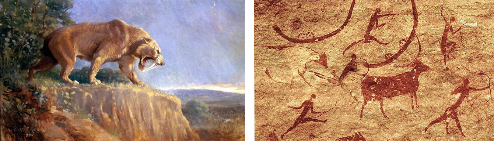
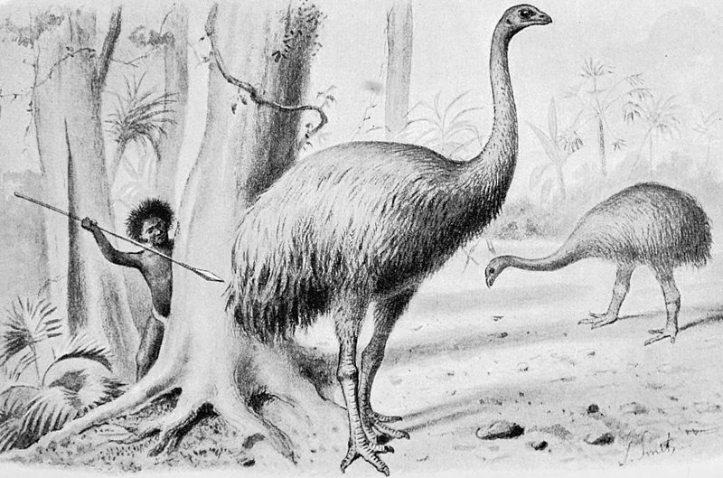
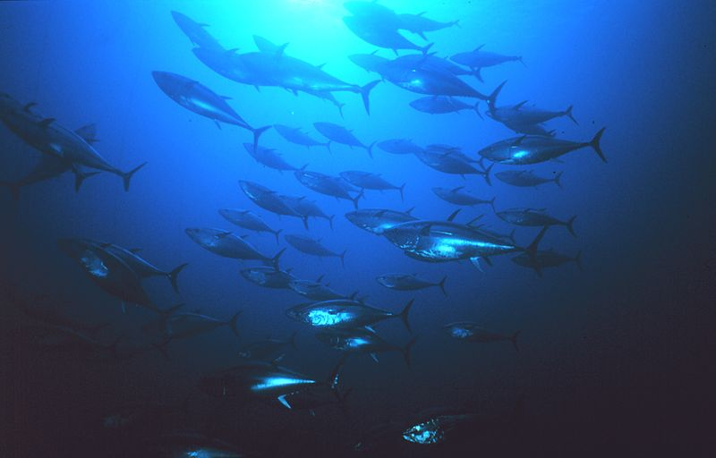
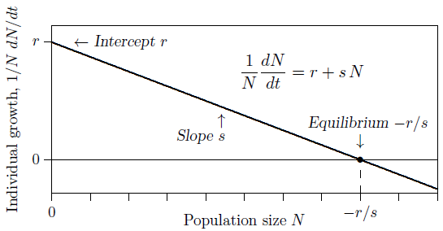
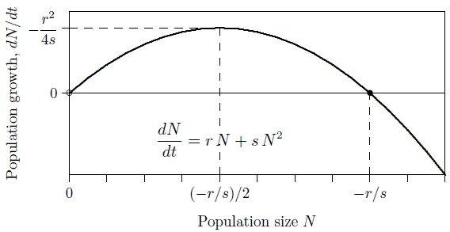
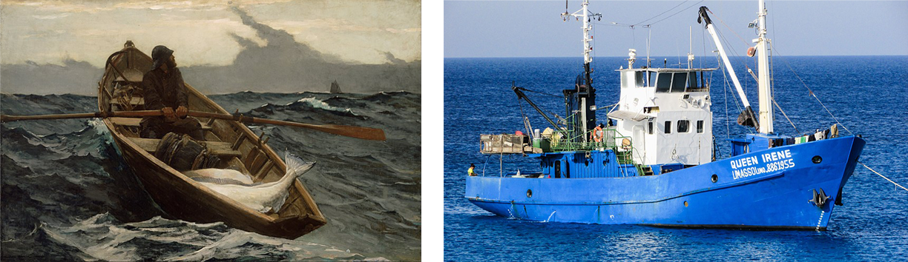
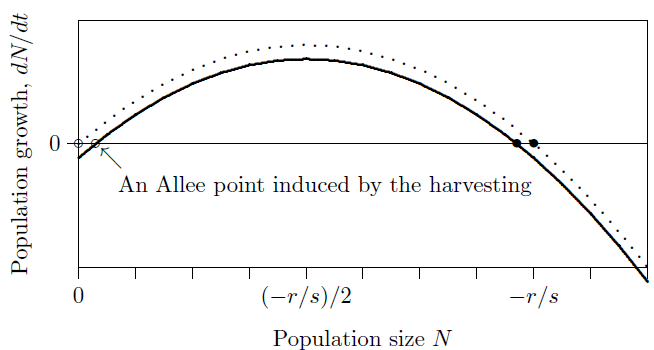
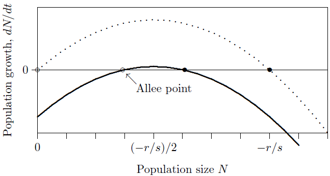
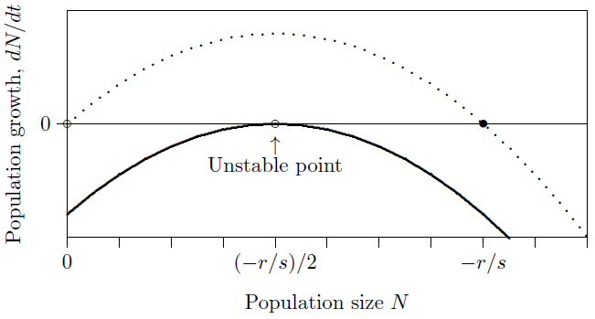
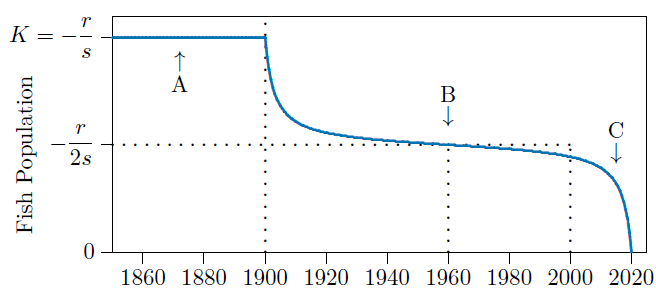

# Humans as predators {#sec-humans-predators}

Early humans suffered from predators just as other primates suffer still.
Eventually, though, they developed spears longer than the longest teeth and
became one of the top predators on land. Even if they did not eat sabre-tooth
tigers, they were able to kill them. We know from vivid paintings on rock walls
in the protected shelter of caves that our ancestors at least fancied themselves
as hunters (@fig-13-1).

Humans are now the dominant large vertebrate on the planet. But on all the
continents beyond Africa, large vertebrates were prominent in the ecosystems
before our ancestors arrived. In Africa many remain, coevolved with humans and
perhaps wiser to our ways. Elsewhere, however, they had little fear when our
ancestors arrived (@fig-13-2).

{#fig-13-1 fig-alt="Left: painting of a sabre-tooth cat on a cliff edge. Right: ancient rock painting of human figures with bows hunting a large horned animal." width="80%"}

{#fig-13-2 fig-alt="Artist's illustration of a human hunter aiming a spear at a towering, unconcerned moa." width="55%"}

The reasons behind the extinction of so many megafauna are controversial.
Archeologist Haynes and others believe humans are responsible.
Archeologist Grayson and others blame climate change, though
animals had been through many glaciations and deglaciations
before. Mammalogist MacPhee and virologist Marx postulate a virulent "hyperdisease" brought by
humans. And geologist Kennett and colleagues assign a comet
impact as the cause---an interesting theory, as some major
human hunters disappeared at about the same time as the larger mammals.

{#fig-13-3 fig-alt="A large school of tuna swimming in deep blue water." width="55%"}

In any case, when something extreme happens, several causes may be working in
concert. We do know from historical records that only about one human lifetime
ago our predecessors in North America hunted bison almost to extinction.
Now the large remaining populations of
megafauna are in the seas (@fig-13-3). What is their fate?

## Consciously controlled predation

Consider predation by humans that is not subject to the cyclical dynamics of
natural predator--prey interactions, but is instead consciously controlled to
provide steady, reliable returns---from the world's fisheries, for example. How
is this attempted?

Recall logistic population growth, where the ecological term $s$ is negative.
@fig-13-4 shows the individual growth rate on
the vertical axis and the population density on the horizontal axis, as you have
seen before. Individual growth means the same thing as growth per capita, or
relative growth, or percentage growth if multiplied by 100. The intention is to
apply this to logistically growing populations of prey.

{#fig-13-4 fig-alt="Straight line of per capita growth rate declining from r at zero population to zero at the carrying capacity." width="55%"}

It is the growth rate of the whole population, however, that is of interest in
controlled predation---not the per capita growth rate---since it is a fraction
of the whole population that is to be taken. So the vertical axis should show
$dN/dt$ rather than $\frac{1}{N}\frac{dN}{dt}$. Start with the individual growth rate, which
reaches its maximum $r$ as $N$ approaches 0. Here the population produces very
few individuals, because the population itself is almost nonexistent.

$$
\frac{1}{N}\frac{dN}{dt} = r + sN
$$

The goal is to maximize the population growth rate so that the greatest number
of prey can be taken. To find that number, multiply both sides of the equation
above by the number of individuals, $N$, to get the growth rate of the entire
population---in other words, to determine how many individuals are added to the
population in a unit of time. The result is

$$
\frac{dN}{dt} = rN + sN^2
$$

The growth of the entire population, $dN/dt$, has the shape of an inverted
parabola, shown in @fig-13-5, since $s$ is
negative. Population growth is lowest when the population is very small, near 0,
or when it is high, near its carrying capacity, $-r/s$. It reaches its maximum
growth rate midway, at half the carrying capacity, $(-r/s)/2$. So if the
population is kept at half its carrying capacity, it will be growing its fastest
and the greatest amount can be "harvested" each year.

{#fig-13-5 fig-alt="Inverted parabola of population growth rate dN/dt against population size, zero at 0 and at the carrying capacity -r/s, with a maximum at half the carrying capacity." width="70%"}

What is that maximum rate? To find it, substitute half the carrying capacity,
$-r/(2s)$, for $N$ in the equation above, giving

$$
\begin{aligned}
\left.\frac{dN}{dt}\right|_{\max}
  &= r\left(-\frac{r}{2s}\right) + s\left(-\frac{r}{2s}\right)^2 \\
  &= -\frac{r^2}{2s} + s\,\frac{r^2}{4s^2} \\
  &= -\frac{r^2}{4s}
\end{aligned}
$$

So in this theory the population grows most rapidly at rate $-r^2/(4s)$,
producing the greatest number of new individuals if drawn down to half its
carrying capacity. This has been called the "maximum sustainable yield."

{#fig-13-6 fig-alt="Left: painting of a lone fisherman rowing a small boat with a large fish aboard. Right: a modern blue motorised fishing vessel at sea." width="70%"}

Let us introduce a harvesting intensity, $H$. When $H$ is zero, there is no
harvesting, and when $H$ is 1, harvesting is at the maximum sustainable rate. In
between it is

$$
\frac{dN}{dt} = \left( rN + sN^2 \right) + H\frac{r^2}{4s}
$$

Let's break this equation down:

- $\frac{dN}{dt}$: the net rate of population growth, the number of individuals per time unit, considering births, deaths, and hunting.
- $\left( rN + sN^2 \right)$: the rate of addition (in parentheses), the number of individuals born per time unit minus those dying from causes other than hunting.
- $H\frac{r^2}{4s}$: the rate of removal, the number of individuals caught per time unit (this term is negative, because $s$ is negative).

If individual fishermen predominate (@fig-13-6, left),
$H$ will be small. This pulls the curve down, as in
@fig-13-7, lowering the carrying capacity slightly and
leaving somewhat fewer fish in the sea. It also introduces an Allee point,
though that point is far below the equilibrium and therefore not a significant
danger.

{#fig-13-7 fig-alt="The growth parabola shifted down slightly, creating an Allee point near zero and a carrying capacity slightly below -r/s." width="70%"}

But with increasingly focused and mechanized fishing
(@fig-13-6, right), $H$ approaches 1 and the curve is
pulled farther down (@fig-13-8). The carrying capacity
is markedly reduced and the population produces new individuals at a large rate.
And the Allee point is pulled close to the carrying capacity, introducing a
danger that unforeseen fluctuations in the population could push the population
below the Allee point and collapse the fishery.

{#fig-13-8 fig-alt="The growth parabola pulled down so its peak is barely above zero; the Allee point and the reduced carrying capacity lie close together near half the original carrying capacity." width="70%"}

{#fig-13-9 fig-alt="The growth parabola pulled down until its peak just touches zero at half the carrying capacity, marked as an unstable point." width="70%"}

Finally, with hunting or fishing at the maximum sustainable yield, the Allee
point coincides with the carrying capacity and in effect annihilates it
(@fig-13-9). This introduces a dynamical conflict because
there is a stable situation to the right but an unstable one to the left, making
it inevitable that the population will fall below the Allee point and collapse.
The maximum sustainable yield is not sustainable!

## Stochastic modelling

@lst-13-1 simulates harvesting at the so-called
maximal sustainable yield. It introduces small random fluctuations in the
population---so small that they cannot be discerned in a graph. The slight
stochasticity makes the program take a different trajectory each time it runs,
with widely different time courses. Inevitably, however, the populations drift
below the Allee point and rapidly collapse, as in the sample run of the program
shown in @fig-13-10.

In the age of sailing, at the arrow marked A, fishing was high-effort but
low-impact and fisheries stayed approximately at their carrying capacity, $K$.
"Optimal harvesting" was introduced once mathematical ecology combined with
diesel technology, and fisheries helped feed the growing human and domestic
animal populations, with fish populations near "maximum sustainable yield,"
as expected. But throughout the 20th century, as shown on either side of the
arrow marked B, fish populations continued to decline, and before 2015---at the
arrow marked C---it becomes clear that something is seriously amiss.

```{r}
#| lst-label: lst-13-1
#| lst-cap: "This program simulates maximal harvesting with small fluctuations in the populations."
#| eval: false
# SIMULATE ONE YEAR
#
# This routine simulates a differential equation for optimal
# harvesting through one time unit, such as one year, taking
# very small time steps along the way.
#
# The 'runif' function applies random noise to the population.
# Therefore it runs differently each time and the collapse
# can be rapid or delayed.
#
# ENTRY: 'N' is the starting population for the species being
#          simulated.
#        'H' is the harvesting intensity, 0 to 1.
#        'K' is the carrying capacity of the species in question.
#        'r' is the intrinsic growth rate.
#        'dt' is the duration of each small time step to be taken
#          throughout the year or other time unit.
#
# EXIT:  'N' is the estimated population at the end of the time
#          unit.

SimulateOneYear = function(dt)
{ for(v in 1:(1/dt))                       # Advance the time step.
  { dN = ((r+s*N)*N + H*r^2/(4*s))*dt;     # Compute the change.
    N=N+dN; }                              # Update the population value.
  if(N<=0) stop("Extinction");             # Make sure it is not extinct.
  assign("N",N, envir=.GlobalEnv); }       # Export the results.

r=1.75; s=-0.00175; N=1000; H=0;           # Establish parameters.

for(t in 1850:2100)                        # Advance to the next year.
{ if(t>=1900) H=1;                         # No harvesting until 1900.
  print(c(t,N));                           # Display intermediate results.
  N = (runif(1)*2-1)*10 + N;               # Apply stochasticity.
  SimulateOneYear(1/(365*24)); }           # Advance the year and repeat.
```

What happened? A collapse is part of the dynamics of this kind of harvesting.
Inevitable stochasticity in harvest combines unfavorably with an unstable
equilibrium in the prey population. In some runs it collapses in 80 years, in
others it may take 300. The timing is not predictable; the main predictable
property of the simulation is that ultimately the system will collapse.

## Present situation

Many of the world's fisheries are under collapse, and in the oceans we seem to
be on a path like the one our predecessor predators took on land.

There are better ecological approaches---a "constant effort" approach, for
example, rather than the "constant harvest" examined here---but economic,
social, and political pressures have kept them from extensive use.

We hope this chapter has shown you that insufficient examination of ecological
equations applied on a large scale can generate disasters, that equilibria must
not be considered apart from their stability, and that management of real
ecological systems requires attention to natural history and social conditions.

{#fig-13-10 fig-alt="Fish population over time from 1850 to 2020: flat at carrying capacity K until 1900 (arrow A), dropping quickly to near half K and declining slowly (arrow B), then collapsing to zero around 2020 (arrow C)." width="80%"}
