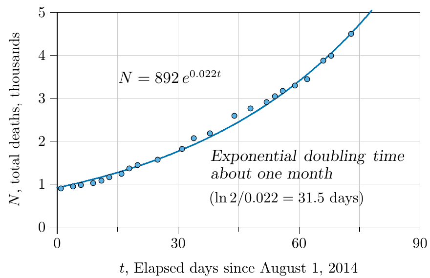
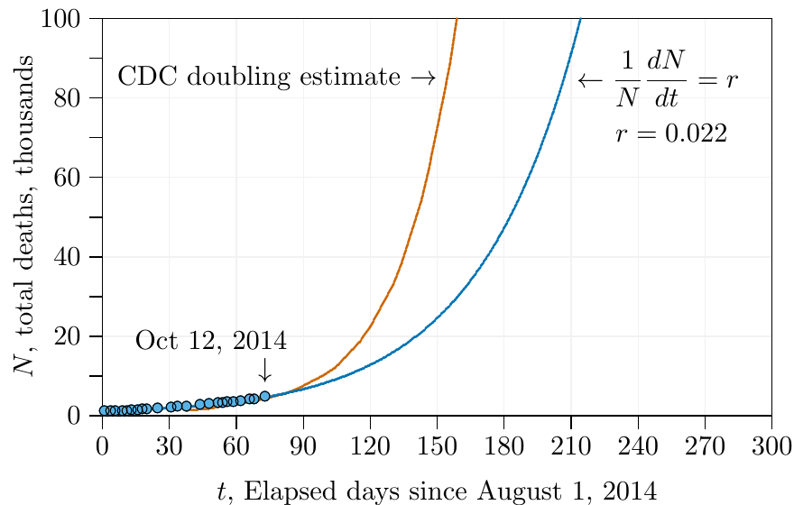
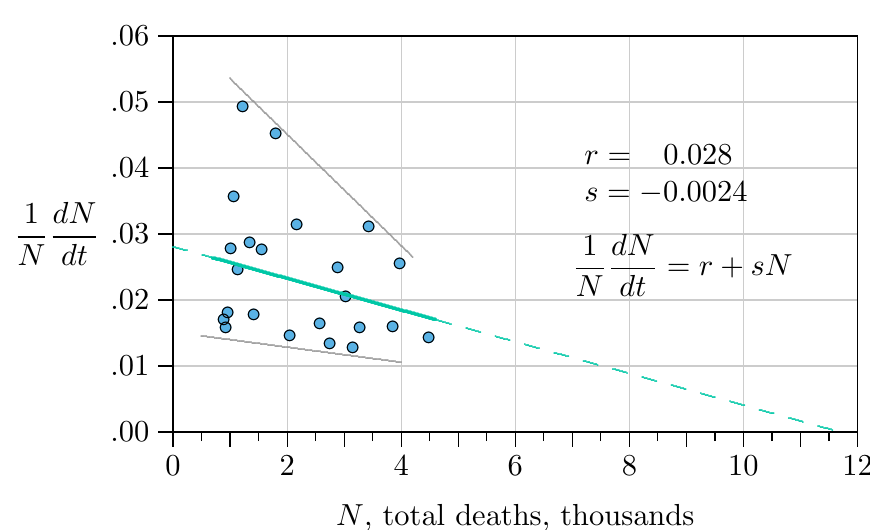
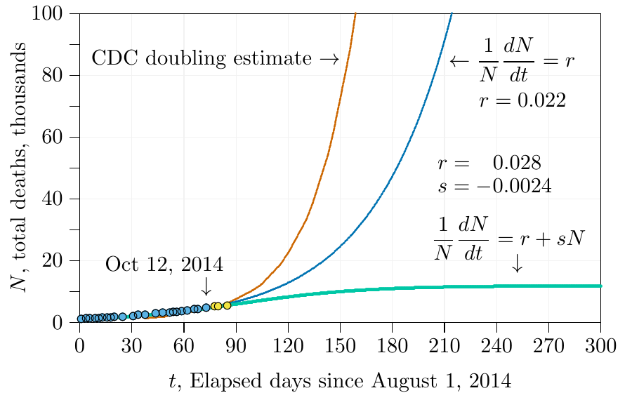
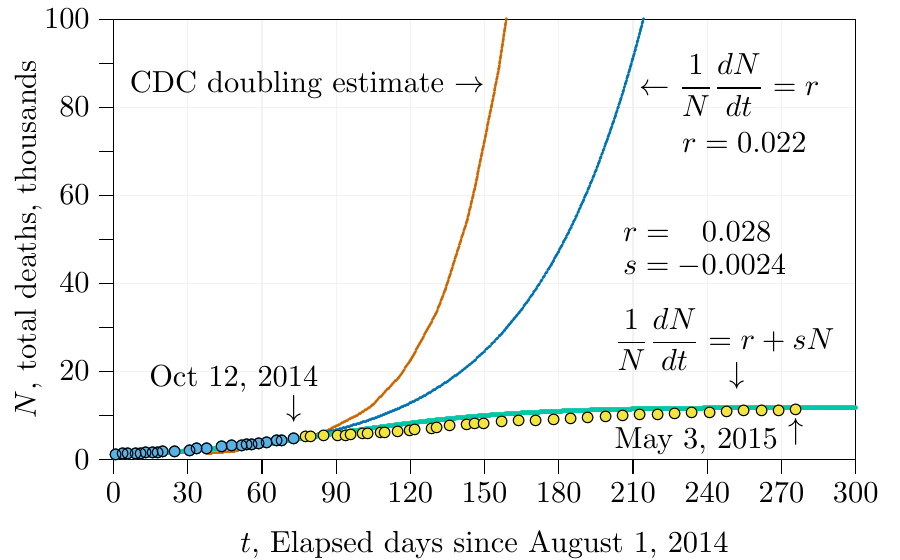

# Theory of disease {#sec-disease}

## New terminology

Terminology of the theory of disease is not completely consistent in the epidemiological literature, but we will use it consistently as follows.

*Virulence:*
: How much or how quickly a pathogen harms its host. Often symbolized as alpha, $\alpha$, in disease equations. Example: if one-tenth of infected organisms die in a particular time period, and everything is random, $\alpha = 1/10$.

*Infectivity:*
: How readily a pathogen arrives at and invades a new host. Often symbolized as beta, $\beta$, in disease equations. Example: in an otherwise uninfected population, if each infected host is expected to infect three others in a particular time period, $\beta = 3$.

*Basic reproductive number:*
: In an otherwise uninfected population, how many new infections an infected individual is expected to produce during the duration of the infection. Often symbolized as $R_0$ in disease equations, and pronounced "are not." This is a crucial number; if $R_0$ is greater than 1, the disease will spread through the population, while if $R_0$ is less than 1, the disease will die out.

## The SIR flowchart

```{dot}
//| label: fig-15-1
//| fig-cap: "Flow through an *SIR* system, a prototypical model of epidemiology. Red arrows are individuals moving between boxes or dying; dashed blue arrows are births."
//| fig-height: 3
//| fig-alt: "Flowchart. Three boxes in a row: Susceptible hosts (S), Infected hosts (I) and Recovered hosts (R). Red arrows run from S to I, labelled beta I times S over S plus I plus R, and from I to R, labelled gamma I. Each box has a red arrow down to a death box, labelled delta S, alpha I and delta R. Dashed blue lines labelled bS, bI and bR run up from each box to a birth box above S, and a red arrow labelled b(S+I+R) runs from birth into S."
digraph SIR {
  graph [rankdir=TB, nodesep=0.9, ranksep=0.55, fontname="Helvetica", bgcolor="transparent"];
  node  [shape=box, style="filled", fontname="Helvetica", fontsize=14, penwidth=1.2, color="#444444"];
  edge  [fontname="Helvetica", fontsize=13, color="#e34948", fontcolor="#222222", arrowsize=0.8, penwidth=1.3];

  birth [label="birth", fillcolor="#fdf6d0", group=gS];
  S [label=<Susceptible<br/>Hosts (<i>S</i>)>, fillcolor="#dbe9fa", width=1.8, height=0.8, group=gS];
  I [label=<Infected<br/>Hosts (<i>I</i>)>,    fillcolor="#dbe9fa", width=1.8, height=0.8, group=gI];
  R [label=<Recovered<br/>Hosts (<i>R</i>)>,   fillcolor="#dbe9fa", width=1.8, height=0.8, group=gR];
  dS [label="death", fillcolor="#eeeeee"];
  dI [label="death", fillcolor="#eeeeee"];
  dR [label="death", fillcolor="#eeeeee"];
  pI [shape=point, width=0, style=invis, group=gI];
  pR [shape=point, width=0, style=invis, group=gR];

  { rank=same; birth; pI; pR; }
  { rank=same; S; I; R; }
  { rank=same; dS; dI; dR; }

  birth -> S [label=<  <i>b(S+I+R)</i>>];
  birth -> S [dir=back, style=dashed, color="#2a78d6", label=<<i>bS</i>  >];
  pI -> I [dir=none, style=dashed, color="#2a78d6", label=<  <i>bI</i>>];
  pR -> R [dir=none, style=dashed, color="#2a78d6", label=<  <i>bR</i>>];
  birth -> pI [dir=back, style=dashed, color="#2a78d6"];
  pI -> pR [dir=none, style=dashed, color="#2a78d6"];

  S -> I [label=<<i>βI·S/(S+I+R)</i>>];
  I -> R [label=<  <i>γI</i>  >];
  S -> dS [label=<  <i>δS</i>>];
  I -> dI [label=<  <i>αI</i>>];
  R -> dR [label=<  <i>δR</i>>];
}
```

A standard starting point for examining the theory of disease is the "SIR model" (@fig-15-1). In this model individuals are born "susceptible," into the box marked $S$ at the left. They may remain there all their lives, leaving the box only upon their ultimate death---marked by the red arrow pointing downward from the box. The label $\delta S$ on this arrow represents the rate of flow from the box---the rate of death of individuals who have never had the disease. The model assumes a per capita death rate of $\delta$ deaths per individual per time unit. If $\delta = 1/50$, then one-fiftieth of the population will die each year. Multiplying by the number of individuals in the box, $S$, gives the flow out of the box, $\delta S$ individuals per year.

The only other way out of the $S$ box is along the red arrow pointing right, indicating susceptible individuals who become infected and move from the left box to the middle box. (The blue arrow pointing up indicates new individuals created by births, not existing individuals moving to a different box.) This rate of flow to the right is more complicated, depending not just on the number of susceptible individuals in the left-hand box but on the number of infected individuals $I$ in the middle box. In the label on the right-pointing arrow out of the $S$ box is the infectivity coefficient $\beta$, the number of susceptible individuals converted by each infected individual per time unit if all individuals in the whole population are susceptible. This is multiplied by the number of individuals who can do the infecting, $I$, then by the probability that an "infection propagule" will reach and infect someone who is susceptible, $S/(S+I+R)$. This is just the ratio of the number in the $S$ box to the number in all boxes combined, and in effect "discounts" the maximum rate $\beta$. The entire term indicates the number of individuals per time unit leaving the $S$ box at left and entering the $I$ box in the middle.

All other flows in @fig-15-1 are similar. The virulence symbolized with $\alpha$ is the rate of death from infected individuals---those in the $I$ box. This results in $\alpha I$ deaths per year among infected individuals, transferring from the blue $I$ box to the gray box below it. Note that if infected individuals can also die from other causes, the actual virulence might be more like $\alpha - \delta$, though the situation is complicated by details of the disease. If a disease renders its victims bedridden, for example, their death rate from other causes such as accidents, such as being hit by a train, may be reduced. Such refinements can be addressed in detailed models of specific diseases, but are best not considered in an introductory model like this.

The other way out of the blue $I$ box in the middle of @fig-15-1 is by recovery, along the red arrow leading to the blue $R$ box on the right. In this introductory model, recovered individuals are permanently immune to the disease, so the only exit from the $R$ box is by death---the downward red arrow---with $\delta R$ recovered individuals dying per year. Note that recovered individuals are assumed to be completely recovered, and not suffering any greater rate of death than susceptible individuals in the $S$ box (both have the same death rate $\delta$.) Again, refinements on this assumption can be addressed in more detailed models of specific diseases.

The blue arrows represent offspring born and surviving, not individuals leaving one box for another. In this introductory model, all individuals have the same birth rate $b$, so that being infected or recovering does not affect the rate. The total number of offspring born and surviving is therefore $b\,(S+I+R)$. This is the final red arrow in @fig-15-1, placing newborns immediately into the box of susceptible individuals.

## The SIR equations

The entire process depicted in @fig-15-1 is equivalent to the following set of equations.

$$
\begin{aligned}
\frac{dS}{dt} &= b(S+I+R) - \beta I\,\frac{S}{S+I+R} - \delta S \\
\frac{dI}{dt} &= \beta I\,\frac{S}{S+I+R} - \gamma I - \alpha I \\
\frac{dR}{dt} &= \gamma I - \delta R
\end{aligned}
$$ {#eq-15-1}

At the left in each equation is the net rate of change of each box, accounting for all arrows transferring individuals out of one box and into another. Again, $S$ is the density of susceptible individuals, $I$ the density of infected individuals, and $R$ the density of recovered individuals. Note that the terms are balanced---the term $\gamma I$, for example, representing individuals entering the recovered box in the last equation, is balanced by the complementary term $-\gamma I$, leaving the infected box in the middle equation.

The SIR model is another ["macroscale model."](https://en.wikipedia.org/wiki/Microscale_and_macroscale_models) With recent changes in computation, ["microscale models,"](https://en.wikipedia.org/wiki/Microscale_and_macroscale_models) processing tens or hundreds of millions of individual hosts, are becoming more widely used. They can reliably take you beyond what purely mathematical formulations can do. More about them in later chapters.

## The SI equations

SIR is also a "frequency-dependent" model, at one end of a spectrum which has "density-dependent" models at the other end. Frequency dependence approximates situations in which infection propagules are limited, while density dependence approximates situations in which potential victims are limited.

But do not be concerned with the full SIR model for now. We shall simplify it here to reveal its basic properties. First, suppose there is no recovery---this is an incurable disease that, once contracted, stays with its victim forever. Many viral diseases approximate this situation---herpes and HIV, for example. In gray below are all the terms that will drop out if there is no recovery.

$$
\begin{aligned}
\frac{dS}{dt} &= b(S+I\color{gray}{+R}) - \beta I\,\frac{S}{S+I\color{gray}{+R}} - \delta S \\
\frac{dI}{dt} &= \beta I\,\frac{S}{S+I\color{gray}{+R}} \color{gray}{-\gamma I} - \alpha I \\
\color{gray}{\frac{dR}{dt}} &\color{gray}{= \gamma I - \delta R}
\end{aligned}
$$

Removing those terms gives an "SI" model.

$$
\begin{aligned}
\frac{dS}{dt} &= b(S+I) - \beta I\,\frac{S}{S+I} - \delta S \\
\frac{dI}{dt} &= \beta I\,\frac{S}{S+I} - \alpha I
\end{aligned}
$$ {#eq-15-2}

But we won't be concerned with this model just now.

## The I equation {#sec-i-model}

We shall simplify the SI model further to an "I" model, the most basic epidemiological formulation. This can be done by considering a constant population, with births always matching deaths. To accomplish this, the birth term, $b(S+I)$, can be made equal to the death term, $\delta(S+I)$, giving

$$
\begin{aligned}
\frac{dS}{dt} &= \delta(S+I) - \beta I\,\frac{S}{S+I} - \delta S \\
\frac{dI}{dt} &= \beta I\,\frac{S}{S+I} - \alpha I
\end{aligned}
$$

However, since the total population---call it $N$---is constant, $S$ is not needed in the equations at all. It is always equal to the total population $N$ minus the number infected: $S = N - I$. You can forget about the $S$ equation and substitute $S = N - I$ into the $I$ equation. This gives

$$
\begin{aligned}
& & \frac{dI}{dt} &= \beta I\,\frac{(N-I)}{(N-I)+I} - \alpha I \\
&\Rightarrow & \frac{dI}{dt} &= \beta I\,\frac{N-I}{N} - \alpha I \\
&\Rightarrow & \frac{dI}{dt} &= \beta I\left(1-\frac{I}{N}\right) - \alpha I \\
&\Rightarrow & \frac{1}{I}\frac{dI}{dt} &= \beta\left(1-\frac{I}{N}\right) - \alpha
\end{aligned}
$$

This is the beginning of the $I$ model. It needs a little more work before proceeding with its analysis, but first some additional terminology:

*Infection:*
: A term applied as soon as a pathogen has taken hold in a host.

*Disease:*
: A term often applied when an infection starts producing symptoms in a host.

*Incidence:*
: The number of new infections or cases of disease appearing in a population per time unit. Often expressed as a fraction of the total population.

*Prevalence:*
: The total number of infections or cases of disease existing in a population. Often expressed as a fraction of the total population.

With this terminology in mind, let us put the $I$ model into the form of prevalence, as a fraction of the entire population. In this case, prevalence is just $p = I/N$. Start where we left off, with

$$
\frac{1}{I}\frac{dI}{dt} = \beta\left(1-\frac{I}{N}\right) - \alpha
$$

multiply through by $I$,

$$
\frac{dI}{dt} = \beta I\left(1-\frac{I}{N}\right) - \alpha I
$$

divide through by $N$,

$$
\frac{d\frac{I}{N}}{dt} = \beta\frac{I}{N}\left(1-\frac{I}{N}\right) - \alpha\frac{I}{N}
$$

substitute prevalence $p = I/N$,

$$
\frac{dp}{dt} = \beta\,p\,(1-p) - \alpha p
$$

and, finally, divide through by $p$,

$$
\frac{1}{p}\frac{dp}{dt} = \beta\,(1-p) - \alpha
$$

Now think about the term $(1-p)$. This "one minus the prevalence" represents the fraction of the population that is susceptible to the disease. But some fraction of the population may have natural immunity to the disease, and another may have been successfully vaccinated against the disease. Let us call this fraction $v$ and subtract it too from the fraction that is susceptible, finally giving

$$
\frac{1}{p}\frac{dp}{dt} = \beta\,(1-v-p) - \alpha
$$ {#eq-15-3}

Whew, that is the final $I$ model---the starting place for analysis!

You will see in an upcoming chapter that @eq-15-3 is identical to a model of habitat destruction in which plants are isomorphic to "infections" of the landscape, and that habitat destruction, which "protects" the landscape from infection by plants, is isomorphic to vaccination.

Here is the equation with term-by-term explanations:

$$
\frac{1}{p}\frac{dp}{dt} = \beta\,(1-v-p) - \alpha
$$

| Term | Explanation |
|:----:|:------------|
| $\dfrac{1}{p}\dfrac{dp}{dt}$ | Relative growth in prevalence under conditions prevailing at time $t$ |
| $\beta$ | Number of new infections induced by each infected individual in each time unit in a completely uninfected population |
| $v$ | Probability of encountering an individual who cannot be infected |
| $p$ | Probability of encountering an infected individual |
| $\alpha$ | Fraction of infected individuals lost per time unit |

Keep in mind that this is a constant-population approximation. Whenever an individual dies of the disease, a new susceptible individual enters the population.

## Analysis of the I model {#sec-i-model-analysis}

With $v$ as the prevalence of vaccination in a population, what will the $I$ model reveal about vaccination? In an uninfected population the prevalence of infection will be zero ($p = 0$), so the number of new infections produced per infected individual per time unit will be $\beta(1-v)$.

On average, a fraction $\alpha$ will die per time unit, so the average duration of infection will be $1/\alpha$, assuming complete randomness. If 1/10 die per year, for example, the average duration of infection will be 10 years.

This makes $R_0(v) = \beta\,(1-v) \times (1/\alpha) = (\beta/\alpha)(1-v)$. And the disease will decline to extinction if $R_0(v) < 1$---that is, if $R_0(v) = (\beta/\alpha)(1-v) < 1$, which you can work out algebraically in a few steps to $v > 1 - \alpha/\beta$.

Look what this means. A disease that infects 4 individuals per year in a totally uninfected population ($\beta = 4$), and which remains infectious for one year ($1/\alpha = 1$), will decline to extinction if $v > 1 - 1/4 = 3/4$. If only slightly more than 3/4 of the population is vaccinated, that disease will eventually vanish. Remarkably, a disease can be eradicated even if the whole population cannot be vaccinated! Largely because of this, society can develop programs striving toward the conquest of disease.

What does the $I$ model reveal about the evolution of infectious disease? The pathogen has many more generations and can therefore evolve biologically more rapidly than the host, and $\alpha$ and $\beta$ can evolve to benefit the pathogen. Because $\beta$ enters the equation with a plus sign and $\alpha$ enters with a minus sign, the disease will spread more rapidly---$(1/p)(dp/dt)$ will be larger---if $\beta$ increases and $\alpha$ decreases. This means that, genetics permitting, a successful disease operating according to this or any similar model will tend to become more infectious (higher $\beta$) and less virulent (lower $\alpha$) over time. At the limit, nearly everybody will be infected but the effect on anybody will be minimal. Polio in humans before the 20th century, and SIV in monkeys, are examples.

In the ultimate limit, a disease could evolve to negative virulence---that is, to be a mutualism with the host. Rhizobial bacteria in legumes may be an example.

As usual, there are refinements to this idea, in part because infectivity and virulence are not independent. Diseases that evolve to be more infectious may have to use more of their victims' metabolic resources, and consequently may become more virulent in the process. Again, such refinements can be addressed in more specific models.

## The rsN model again {#sec-rsn-again}

Let's return to shorter time frames without evolution. Notice that prevalence $p$ changes with time as the epidemic spreads, but $\beta$, $\alpha$, and $v$ remain constant. So starting with

$$
\frac{1}{p}\frac{dp}{dt} = \beta(1-v-p) - \alpha
$$

rearranging terms,

$$
\frac{1}{p}\frac{dp}{dt} = \big(\beta(1-v) - \alpha\big) - \beta p
$$

and substituting $r = \beta(1-v) - \alpha$, $s = -\beta$, and $N = p$,

$$
\frac{1}{N}\frac{dN}{dt} = r + sN
$$

Voilà, the epidemiological $I$ model is revealed to be just the standard model of ecology in another disguise! But now, with mechanisms included (infectivity, virulence, vaccination), deeper conclusions can be reached.

In getting to this standard model, for example, we set $s$ equal to $-\beta$. Because $\beta$ is positive, the density dependence term $s$ is negative. Negative $s$ implies logistic growth (positive $s$ is orthologistic), meaning that $N$ will reach a carrying capacity---an equilibrium, a steady state. But to arrive at the standard model, we set $N$ equal to $p$, so since $N$ reaches an equilibrium in the standard model, the prevalence $p$ will reach an equilibrium in the $I$ model.

Without further analysis you can therefore conclude that a disease will not necessarily infect an entire population, but that its prevalence will level out when it reaches a carrying capacity, at the equivalent of $-r/s$. Substitute backwards ($r = \beta(1-v) - \alpha$ and $s = -\beta$) and you will find the carrying capacity of the disease:

$$
\hat{p} = 1 - \frac{\alpha}{\beta} - v
$$ {#eq-15-4}

The small hat atop the $p$ is just a reminder that this is not the variable prevalence $p$, but rather the fixed value of the equilibrium prevalence, $\hat{p}$.

Think about the approach in @sec-i-model-analysis, which used $R_0$. Here is another way to get the result. Since $v$, the proportion of the population vaccinated, appears in the equation with a minus sign, that means that the greater the proportion vaccinated, the lower the equilibrium prevalence $\hat{p}$. In fact, setting $\hat{p} = 0$ and solving for $v$, when $v = 1 - \alpha/\beta$, the prevalence $p$ will be zero and the disease will be eradicated. (Actually, for a margin of error, when $v \ge 1 - \alpha/\beta$).

## Application to an actual outbreak

An ominous outbreak of [Ebola](https://en.wikipedia.org/wiki/West_African_Ebola_virus_epidemic) in West Africa became widely known in 2014, with the rate of deaths repeatedly doubling and redoubling. By the fall of that year cases started appearing on other continents.

Ebola apparently enters human populations from wild animals such as bats, in whom it is not particularly virulent. It has not, however, adapted to the human body (@fig-14-5, right). It becomes such a dread disease in humans because it exploits almost all of the body's exit portals (@tbl-14-1)---not simply by finding limited passages through them, but by completely destroying them. Some diseases may induce vomiting or diarrhea, for example, as a means for the pathogen to exit the alimentary canal, but with Ebola, entire tissue systems are destroyed and chunks of intestine accompany the exit.

At the time of the outbreak, two of us (cl, sw) were jointly teaching courses in the United States in quantitative ecology and in the ecology of disease, using tools illustrated thus far in this book. A level of fear prevailed in the country because the disease had just reached the U.S., with a few deaths in U.S. hospitals. Along with our students, we decided to make Ebola a case study for application of the disease equations, applying the principles week-by-week as the outbreak was advancing. Hundreds of thousands of deaths had been predicted by health organizations. This section describes what we did and what we discovered.

**Real-time data.** Data from the World Health Organization ([WHO](https://en.wikipedia.org/wiki/World_Health_Organization)) and other official sources had been tabulated on a [website about Ebola in West Africa](https://en.wikipedia.org/wiki/West_African_Ebola_virus_epidemic), and you can select a date there to see exactly which data were available when we started tracking the outbreak, or at any subsequent time. The site listed both the number of individuals infected with Ebola and the number who had died, but in the early days of the outbreak we guessed that the number of deaths would be more reliable. Moreover, the world was paying greatest attention to deaths, so we hypothesized that these numbers would most strongly influence social efforts to combat the disease.

{#fig-15-2 fig-alt="Total Ebola deaths in thousands against elapsed days since August 1, 2014, from 0 to 90 days. Points rise from about 0.9 thousand to 4.5 thousand along a fitted exponential curve N = 892 e^(0.022 t), annotated 'Exponential doubling time about one month (ln 2 / 0.022 = 31.5 days)'." width="80%"}

We thus started with total deaths, plotting them as in @fig-15-2. The number of deaths was not only increasing but accelerating, seemingly on an exponential course. The calculated doubling time (@eq-5-4) was 31.5 days, not quite what U.S. Centers for Disease Control ([CDC](https://en.wikipedia.org/wiki/Centers_for_Disease_Control_and_Prevention)) had found earlier, but within reasonable correspondence. They estimated 15--20 days to double in one country and 30--40 in another (Meltzer et al., 2014).

Calculating from these doubling times and extending for several more months results in the number of deaths shown in @fig-15-3. Before five months with the estimates we made during class (blue curve in the figure) and before three months with the earlier estimates (red curve), the number of deaths was predicted to exceed 100,000.

{#fig-15-3 fig-alt="Total Ebola deaths in thousands against elapsed days since August 1, 2014, from 0 to 300 days. Data points up to October 12, 2014 lie near zero; a red curve labelled 'CDC doubling estimate' passes 100 thousand at about day 160, and a blue exponential curve with r = 0.022 passes 100 thousand at about day 215." width="80%"}

But there is a flaw in this approach. As shown by the calculations on bacteria and Darwin's calculations on elephants in @sec-basic-population-model, exponential growth models cannot be extended very far. They can be quite accurate a limited number of time units in the future. But when applied to biological populations both exponential and orthologistic models inevitably fail when extended indefinitely. Actually, one view is that they do not really fail---they just warn that some other growth model will supplant them before populations grow too large.

| Days | Years | Total deaths |
|-----:|------:|-------------:|
| 0 | 0.00 | 892 |
| 100 | 0.27 | 8,412 |
| 200 | 0.55 | 79,335 |
| 300 | 0.82 | 748,267 |
| 400 | 1.10 | 7,057,440 |
| 500 | 1.37 | 66,563,800 |
| 600 | 1.64 | 627,811,000 |
| 700 | 1.92 | 5,921,330,000 |
| 710 | 1.94 | 7,411,030,000 |

: Consequences of unlimited doubling in Ebola deaths. {#tbl-15-1}

In fact, assuming the unrestrained doublings of exponential growth is tantamount to assuming a disease will kill the entire world, with the only question being when. @tbl-15-1 shows the results of doubling at the rate illustrated by the blue curve in @fig-15-3, extended farther. At this rate the entire human population would be extinguished in less than two years!

**Expected moderation.** Of course, the entire human population will not be extinguished by a manageable disease. Draconian measures would be put in place long before---isolating those infected, closing borders, and more. In effect, the growth rate $r$ will be moderated by strong negative social pressure, term $s$.

When would such negative pressure appear in the data? Could it be seen early in the Ebola outbreak, when we and the students began watching? Because the basic disease equation is equivalent to the $rsN$ model (@sec-rsn-again), we thought early trends might appear if we examined the data in terms of $r$ and $s$. The individual growth rate in deaths, $(1/N)\,dN/dt$, could be examined and plotted against the total number of deaths, $N$. This is @fig-15-4, with the same data as @fig-15-2, just reformulated.

{#fig-15-4 fig-alt="Scatter of per capita death growth rate (1/N dN/dt, 0 to 0.06) against total deaths in thousands (0 to 12). Noisy points between 1 and 4.5 thousand deaths trend downward. Two gray lines bound the upper and lower points; a solid green regression line with r = 0.028 and s = -0.0024 continues as a dashed line that reaches zero near 12 thousand deaths." width="80%"}

The data show quite a bit of noise, but with a clear downward trend, with the rate in the total number of new deaths decreasing as deaths increase. Both the upper and lower ranges of points are decreasing (gray lines). The green line through the averages (least-square regression line, solid, with $r$ and $s$ as shown in the figure) projects forward (dashed) to about 12,000 deaths before the outbreak would be over---an extensive human tragedy, but far below the straightforward projections of @fig-15-3.

If this decline in death rate was real, it was likely developing from more and more attention to moderating the disease---medical workers expanding hospitals, populations practicing more careful burials, governments cautioning only justified travel, and the like. When we made the projection of 12,000 in the fall of 2014, we had no certainty about what would happen; we were simply looking at the data, which showed not unrestrained exponential growth, but moderating growth instead.

The next step was to plug the $r$ and $s$ derived from the fitted curve into @eq-5-2 and project forward six months or a year. This projection is shown in @fig-15-5. The green curve is the projection from $r = 0.028$ and $s = -0.0024$. It is markedly different than the other two curves, leveling off early and reaching about 12,000 deaths. Also in the figure are three additional points of actual data, in yellow, not sufficiently advanced to tell which of the three curves---red, green, or blue---will be the real one.

{#fig-15-5 fig-alt="The plot of Figure 15.3 with an added green logistic curve, r = 0.028 and s = -0.0024, that levels off at about 12 thousand deaths, and three yellow data points just after October 12, 2014 lying on all three curves." width="80%"}

In only a few weeks, however, it became apparent that the $r+sN$ curve was the most accurate. By the end of the winter semester (about day 140 in the graphs) it was clear that the outbreak was coming under control, and that the number of deaths was fairly close to our initial projection.

After tracking the outbreak with our students through the winter and spring semesters, we could see how remarkable that early projection was (@fig-15-6). Reading the data carefully early in the crisis gave an accurate projection of the outcome, from a simple model indeed!

{#fig-15-6 fig-alt="The plot of Figure 15.5 with yellow data points continuing to May 3, 2015 (about day 275); they follow the green logistic curve, levelling off at about 11 thousand deaths, far below the blue and red exponential curves." width="80%"}

**Doubling times.** This example provides a good place for us to reconsider doubling times (@eq-5-4), introduced with exponential growth in @sec-differential-difference. Recall that exponential growth is the infinitely thin dividing line between logistic and orthologistic growth, and has the property of a fixed "doubling time." In other words, there is a specific time interval---call it tau ($\tau$)---during which the population exactly doubles. In logistic growth the doubling time constantly increases, while in orthologistic growth it constantly decreases. In @eq-5-4 the doubling time is shown to be the natural logarithm of 2 divided by $r$---$(\ln 2)/r$, or approximately $0.693/r$. This is in years if $r$ is measured per year, days if per day, and so forth.

Thus the doubling time for the exponential curve of @fig-15-2, with $r = 0.022$, is $0.693/0.022 = 31.5$ days. The logistic growth of @fig-15-4 has no fixed doubling time. However, at all times there will be an "instantaneous doubling time," which will hold approximately for a short time. In particular, near the very beginning of the outbreak---when $N$ is close to 0---the growth rate is $r+sN = r+s \cdot 0 = r$. For the Ebola data early in the outbreak, we found $r = 0.028$ and $s = -0.0024$. The Ebola doubling time, averaged over the countries in which it spread, therefore started out at $0.693/r = 0.693/0.028 = 25$ days. This is in accord with early estimates made by health organizations.

When we began following the outbreak, about 4.5 thousand deaths had occurred, meaning that the growth rate was $r+sN = 0.028 - 0.0024 \cdot 4.5 = 0.0172$, and the doubling time was $0.693/0.0172 = 40$ days.

The doubling time continued to increase until the outbreak was conquered and all deaths from Ebola ceased.

**Caveats and considerations.** There was some fortuity in the timing of our initial projection. Shortly after we started the death rate dropped, possibly from increased efforts following intense world-wide attention. Had we made the projection a few weeks later we would have seen two slopes and would have had to guess which would prevail. It turns out that the first slope prevailed, returning about 40 days after our initial projection. But we had no way to know this from the data at the time.

Our approach could also be criticized because the $r+sN$ equation we used is a hybrid---a single equation trying to represent two different things, in this case infections and deaths. It is reasonable here to base the amelioration parameter $s$ on the total number of deaths, since deaths were the parameter of world concern. Deaths influence social attention to the disease and efforts to control it. However, what sense is there in saying that deaths grow at rate $r$, based on the total number of deaths thus far? Ebola can be transmitted to others shortly after death, but in general deaths do not cause new deaths. Infections cause new infections, which in turn cause new deaths. If $N$ represents total deaths, it seems the equations should also have an $I$ to represent infections, and some fraction of infections should result in deaths---as in this two-dimensional system of equations.

$$
\begin{aligned}
\frac{dI}{dt} &= \beta\,I - \gamma\,I - \alpha\,I - s\,N\,I \\
\frac{dN}{dt} &= \alpha\,I
\end{aligned}
$$ {#eq-15-5}

The two dimensions are $I$, the number of existing infections, and $N$, the cumulative number of deaths. Infectivity is $\beta$, the rate of recovery from infection is $\gamma$, and the rate of death from the disease is $\alpha$. These correspond to the notation in @fig-15-1. In addition, the term $sN$ moderates the growth of the infection by representing all the cautions and infrastructure put in place against the disease as the number of deaths increased.

No factor like $1-v-p$, representing the fraction of susceptible individuals as in @eq-15-3, is needed to multiply the $\beta$ term here, because both in the early stage and throughout the outbreak the prevalence was low and there was no vaccine, so almost everyone was susceptible. And with this rapidly progressing disease the population remained almost constant, so births could be considered negligible. @eq-15-5 is thus still a simplified equation.

As simplified as it is, however, @eq-15-5 carries more parameters than can be perceived in the raw data. The death rate from the disease $\alpha$, the recovery rate $\gamma$, the infectivity $\beta$, and even the number of infections $I$, can only be discovered through the use of special research programs. But even at the beginning of an outbreak, and even for a poorly understood disease, there may be enough data to determine the doubling time for deaths from the disease, and how the doubling time is changing---enough data to determine $r$ and $s$, even if little more.

This is fortunate, because @eq-15-5 can be reduced in dimension and approximated by the $r+sN$ form. Without the amelioration term $sNI$, the two dimensions are independent and growth of each is exponential, with $N$ being the integral of $I$. Because the integral of an exponential is still exponential, the two can be approximated by a single equation of one fewer dimension, with the amelioration term $sNI$ reinstated. In this way, total deaths become a legitimate surrogate for infections in low-prevalence outbreaks, as in the present example of Ebola.

And as we noted, this gave an accurate projection on the course of a dread disease, from a very simple model indeed!

## Conflicting ethics

Fundamental conflicts in ethical behavior are hidden just below the surface of the cold mathematics in these equations, particularly in @eq-15-4. Virulence $\alpha$ appearing in the numerator of a term with a minus sign means that the greater the virulence, the lower the equilibrium level of disease, $\hat{p}$. In the absence of vaccination ($v = 0$), setting $\hat{p} = 0$ and solving for $\alpha$ yields $\alpha = \beta$. Artificially increasing the virulence $\alpha$ of a disease to equal or exceed the infectivity $\beta$ will therefore drive the disease extinct.

The enduring ethical conflict here is between the individual and the population. With all other things being equal, working to reduce virulence benefits the individual but may cause more individuals in the population to become infected. Working to increase virulence, in contrast, harms individuals but may reduce the number who become infected.

The ethics of modern medicine emphasizes individuals---working to cure disease and reduce virulence, ameliorating symptoms, reducing discomfort, and recognizing patient needs. Increasing the virulence of a disease in a human patient to reduce its spread is unthinkable, both in medicine and public health. The ethics of modern agriculture, however, are the diametric opposite. If a crop is infected with a destructive communicable disease, entire fields of the crop may be mowed, burned, or otherwise disposed of. Infected populations of poultry and livestock are treated similarly, killed en masse and buried or burned to contain the disease.

![Funeral pyre of infected cows. Exterminating a living organism when it is infected artificially increases the virulence of the disease to something like $\alpha \to \infty$. [Photo: public domain.]{.credit}](img/fig_15_7.jpg){#fig-15-7 fig-alt="Carcasses of cattle burning in a long row on a muddy field, with two workers, one in a white protective suit, standing nearby." width="55%"}

Artificially altering the infectivity $\beta$ is also a possibility. In @eq-15-4, $\beta$ appears in the denominator of a term having a minus sign---meaning that decreasing $\beta$ will decrease the equilibrium level of the disease, $\hat{p}$. Ethical conflicts also arise here, though they are not as stark as the conflicts connected with $\alpha$.

During the influenza epidemic of 1918--19, San Francisco leaders required citizens to wear breathing masks---for "conscience, patriotism, and self-protection," wrote the mayor. This lowered $\beta$ by containing respiratory droplets from infected individuals, and lowered the chance of infected droplets entering the respiratory systems of susceptible individuals, in turn reducing the infectivity $\beta$. Some citizens, however, refused to wear the masks.

During the Ebola outbreak of 2014--15, amidst fears and warnings of the disease becoming established around the world, some U.S. governors ordered temporary quarantine of returning medical workers who had been in direct proximity with Ebola, until it was clear that they were not infected. At least one refused the quarantine based on individual rights, and the courts upheld the refusal.

These ethical conflicts surrounding $\beta$ are not as grim as those surrounding $\alpha$, with options currently practiced for domestic plants and animals but so extreme that they are never proposed for human populations.

It is curious that these high-level social dilemmas are perceptible within the most basic equations of ecology. Science can inform such ethical issues, but society must decide them.

![The slogan "Obey the laws and wear the gauze" accompanied regulations intended to protect public and individual health in 1918--19 San Francisco. Thousands of city residents died of influenza, but at a rate lower than that of many other cities. Most of the public complied with the regulations; some who refused were quarantined in jail. Pictured above are police officers in Seattle in 1918. [Photo: public domain.]{.credit}](img/fig_15_8.jpg){#fig-15-8 fig-alt="Black-and-white photograph of a line of uniformed police officers in long coats and caps, each wearing a white gauze face mask, standing on a cobbled street." width="80%"}
