# Competition {#sec-competition}

```{r}
#| include: false
source("_common.R")
```

Ecological competition is a potent force driving organic evolution. When [Charles Darwin](https://en.wikipedia.org/wiki/Charles_Darwin) reached the [Galapagos Islands](https://en.wikipedia.org/wiki/Galápagos_Islands) at age 26, he studied an assortment of fifteen similar species that are now called ["Darwin's Finches"](https://en.wikipedia.org/wiki/Darwin's_finches) (@fig-16-2). His observation that various species had different beak structures, specialized for different foods, led him to question the stability of species. Indeed, such "character displacement" is one of several consequences of ecological competition.

![The Galapagos Archipelago, on the equator more than 500 miles off the west coast of South America. [Photo: Antti Lipponen, CC BY 2.0.]{.credit}](https://live.staticflickr.com/2914/32905506520_29393f7a17_b.jpg){#fig-16-1 fig-alt="Satellite view of the Galapagos Islands, a scattered group of dark volcanic islands in a deep blue ocean." width="80%"}

::: {#fig-16-2 layout-ncol=3}
![Sharp-beaked ground finch. [Photo: Daderot, CC0.]{.credit}](https://upload.wikimedia.org/wikipedia/commons/thumb/2/29/Geospiza_difficilis_-_Hessisches_Landesmuseum_Darmstadt_-_Darmstadt%2C_Germany_-_DSC00096.jpg/960px-Geospiza_difficilis_-_Hessisches_Landesmuseum_Darmstadt_-_Darmstadt%2C_Germany_-_DSC00096.jpg){#fig-16-2-a fig-alt="Museum specimen of a small dark finch with a slender, pointed beak."}

![Cactus ground finch. [Photo: Daderot, CC0.]{.credit}](https://upload.wikimedia.org/wikipedia/commons/thumb/c/cf/Geospiza_scandens_-_Hessisches_Landesmuseum_Darmstadt_-_Darmstadt%2C_Germany_-_DSC00109.jpg/960px-Geospiza_scandens_-_Hessisches_Landesmuseum_Darmstadt_-_Darmstadt%2C_Germany_-_DSC00109.jpg){#fig-16-2-b fig-alt="Museum specimen of a dark finch with a long, slightly curved beak."}

![Large ground finch. [Photo: Daderot, CC0.]{.credit}](https://upload.wikimedia.org/wikipedia/commons/thumb/0/01/Geospiza_magnirostris_-_Hessisches_Landesmuseum_Darmstadt_-_Darmstadt%2C_Germany_-_DSC00101.jpg/960px-Geospiza_magnirostris_-_Hessisches_Landesmuseum_Darmstadt_-_Darmstadt%2C_Germany_-_DSC00101.jpg){#fig-16-2-c fig-alt="Museum specimen of a heavy-set dark finch with a very deep, massive beak."}

Three species of Darwin's finches: sharp-beaked ground finch, *Geospiza difficilis* (left); cactus ground finch, *G. scandens* (middle); and large ground finch, *G. magnirostris* (right).
:::

::: {.epigraph}
Seeing this gradation and diversity of structure in one small, intimately related group of birds, one might really fancy that from an original paucity of birds in this archipelago, one species had been taken and modified for different ends.

[--- Charles Darwin]{.attribution}
:::

## The niche concept

A species' niche is the range of environmental factors that allow that species to survive and reproduce. A particular tree species, for example, may be able to live where temperatures do not drop below $-40^\circ$, and where yearly precipitation is at least 750 mm. Perhaps it also needs open sunlight and an appropriate collection of [root fungi](https://en.wikipedia.org/wiki/Mycorrhiza). Such are the parameters of a niche.

[G. Evelyn Hutchinson](https://en.wikipedia.org/wiki/G._Evelyn_Hutchinson), one of the great ecologists of the twentieth century, envisioned the parameters that form a niche as an "$n$-dimensional hyperspace." The "fundamental niche" is the set of conditions allowing the species to survive if there are no other species interfering. Physical conditions are chief among those. The "realized niche" is the real life niche---where species are restricted by interactions with other species.

Consider latitude on the earth's surface, which is connected to several parameters such as sunlight and temperature. And consider two species that can thrive anywhere between $40^\circ$ and $60^\circ$ latitude, and whose density drops slowly with increasing latitude (@fig-16-3).

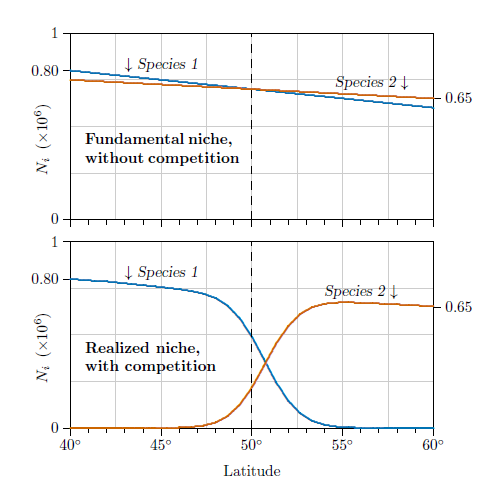{#fig-16-3 fig-alt="Two stacked graphs of abundance against latitude from 40 to 60 degrees. Top, fundamental niche without competition: blue Species 1 and red Species 2 both decline gently and nearly overlap. Bottom, realized niche with competition: Species 1 dominates in the south and Species 2 in the north, with a sharp switch just north of 50 degrees." width="80%"}

At the top of the figure are two nearly horizontal lines representing the abundance you might observe of the two species as you travel north. If free of Species 2 (its competitor), Species 1 (blue line) declines slowly in abundance in more northerly climates. Species 2 similarly declines in abundance (red line), but compared with Species 1 fares a little better in the north and a little worse in the south.

When these two species are together they compete with each other---each suppressing the other. Using competition equations like those presented in this chapter, we see that in the south, where Species 1 fares better, it takes over and dominates. In the north, in contrast, where Species 2 fares better, it dominates instead (@fig-16-3, bottom).

You see that there can be a sharp change in abundance even with only very slight changes in species characteristics. A range of one species can end and that of a new species can begin, even though you may not be able to discover anything from either species alone as to why they switch their dominance. And the switch-over point need not correspond exactly to the place where the two species' growth characteristics cross. Here the actual switch-over point is a few degrees to the north because of the migration simulated in the model. This phenomenon is called "competitive exclusion" and, when it occurs over space like this, "zonation."

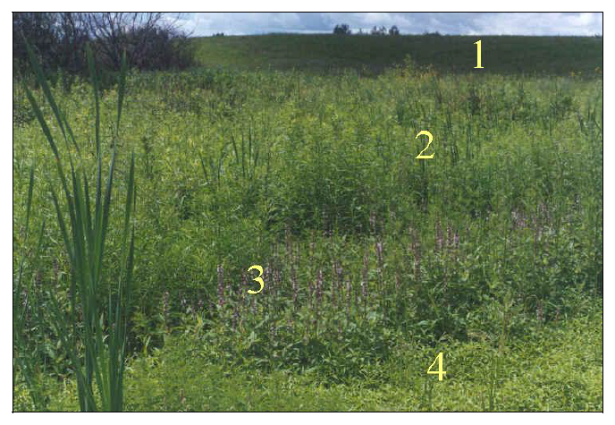{#fig-16-4 fig-alt="Photograph of a restored prairie sloping down into a wet depression, with distinct bands of vegetation labelled 1 (upland grasses) through 4 (low, moist ground), including cattails in the foreground and purple-flowered plants in zone 3." width="80%"}

Any environmental gradient can induce zonation. @fig-16-4 illustrates this on a restored prairie in the North American Upper Midwest. Though less than ten meters, the variation in elevation is enough to induce a mild moisture gradient. The entire area had been converted from a corn field to a restored prairie and seeded uniformly with a mixture of prairie grasses and prairie flowers, but distinct boundaries arose only three years after restoration.

All the upland areas, labeled 1, contained standard restored prairie flora such as [*Andropogon gerardi*](https://en.wikipedia.org/wiki/Andropogon_gerardi) (Big Bluestem grass) and rapidly emerging flowers such as [*Rudbeckia hirta*](https://en.wikipedia.org/wiki/Rudbeckia) (Black-eyed Susan). But in successive zones surrounding mild depressions in the landscape, labeled 2 to 4, there were sharp transitions to moisture-loving genera such as [*Typha latifolia*](https://en.wikipedia.org/wiki/Typha_latifolia) (cattail) and [*Stachys palustris*](https://en.wikipedia.org/wiki/Stachys_palustris) (marsh woundwort).

::: {.callout-note}
*Fundamental niche*: The conditions under which a species can live, absent interference from other species.

*Realized niche*: The conditions to which a species is restricted by interactions with other species.
:::

## Resource competition

Competition among two species occurs when the interaction terms $s_{1,2}$ and $s_{2,1}$ in @eq-8-1 are both negative. This rather abstract approach does lead to broad insights, but for other kinds of insights let us proceed to a more *mechanistic* view. Instead of abstract coefficients representing inhibition among species, let us consider *resources* which species need to thrive and survive. The species will not interact directly---they never even need to come into contact---but will influence each other through their use of a common resource, which they both need for maintenance and growth of their populations.

Resource competition is one of the oldest parts of ecological theory, introduced in the late 1920s by mathematician [Vito Volterra](https://en.wikipedia.org/wiki/Vito_Volterra). We will start where he started, considering what have been called "abiotic resources".

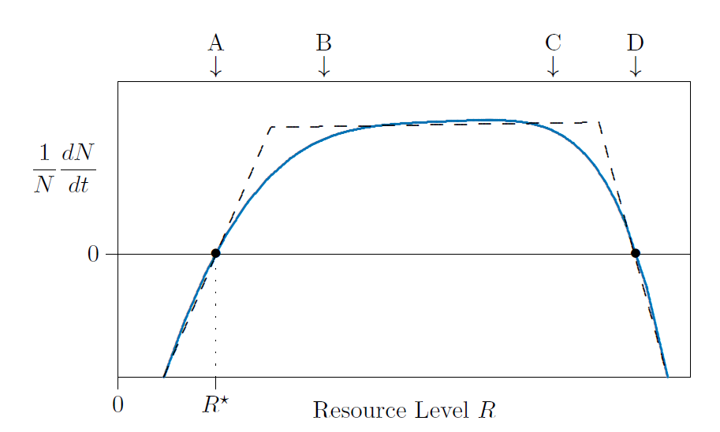{#fig-16-5 fig-alt="Individual growth rate (1/N)(dN/dt) against resource level R. A blue curve rises from negative values, crosses zero at R-star (point A), levels off between points B and C, then falls and crosses zero again at point D. Dashed straight-line segments approximate the curve." width="80%"}

Species require sunlight, space, nitrogen, phosphorous, and other resources in various amounts. If a resource is too rare, populations cannot grow, and in fact will decline. In @fig-16-5 this is shown in the region to the left of the arrow marked A, in which the individual growth rate $1/N\,dN/dt$ is negative.

At higher resource levels the growth rate increases and, at point A, the population can just barely maintain itself. Here the individual growth rate $1/N\,dN/dt$ is zero. This level of resources is called $R^\star$, pronounced "are star". At higher levels of resource, above $R^\star$, the population grows because $1/N\,dN/dt$ becomes positive.

Once resources are abundant---approximately above B in the figure---needs are satiated and the addition of more resources does not make any large difference. Population growth stays approximately the same between marks B and C.

At very high levels, too much resource can actually harm the population. Too much sunlight can burn leaves, for example, while too much nitrogen can damage roots. At this point, above C in @fig-16-5, the growth rate starts falling. By D the species can again just barely hold its own, and to the right of D the species is killed by an overabundance of resources.

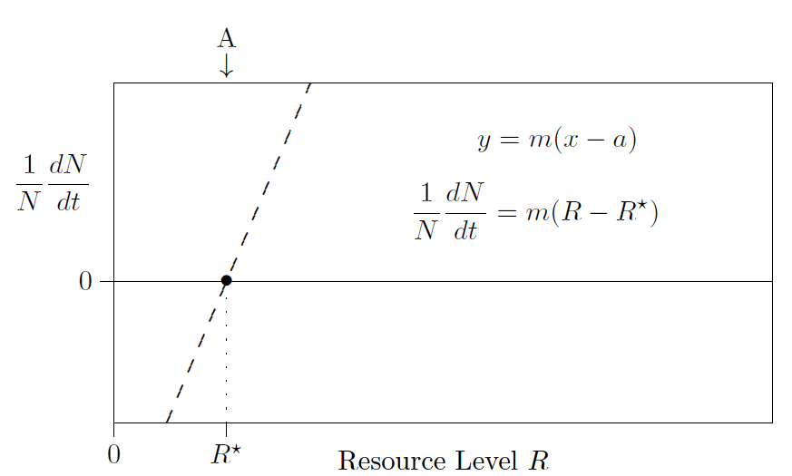{#fig-16-6 fig-alt="Individual growth rate against resource level R, showing a single dashed straight line rising through zero at R-star (point A), labelled with the equations y = m(x - a) and (1/N)(dN/dt) = m(R - R-star)." width="80%"}

Such high resource levels, however, are not usually observed, because species draw resources concentrations down by using them up. Unless extreme environments are being modelled, only the left dashed linear piece of @fig-16-5 needs to be modelled, as shown in @fig-16-6.

At this point, it is helpful to review various forms for the equation of a straight line. The usual slope--intercept form---$y=mx+b$, which is a $y$-intercept form---is not as useful here. It's the $x$-intercept form, $y=m(x-a)$, that comes into play for writing a mechanistic resource model for single species population growth.

::: {.callout-note}
1. Slope--intercept form: $y = mx+b$ (slope $m$, $y$-intercept $b$).
2. Intercept--intercept form: $y = b(1-x/a)$ ($x$-intercept $a$, $y$-intercept $b$; $m=-b/a$).
3. Slope--$x$-intercept form: $y = m(x-a)$ (slope $m$, $x$-intercept $a$; $m=-b/a$).
:::

The zero-growth point, $R^\star$, is important in the theory of resource competition. It is the amount of resource that just barely sustains the species. If the resource level is less than $R^\star$, the species dies out; if it is greater, the species grows and expands. The resource level in the environment therefore is expected to be at or near the $R^\star$ value of the dominant species. If it is above that level, the population grows, new individuals use more resource, and the resource level is consequently reduced until growth stops.

$R^\star$ can be measured in the greenhouse or the field. In the greenhouse, for example, you might arrange plants in 20 pots and give them different amounts of nitrogen fertilizer in sterile, nutrient-free soil. In the complete absence of fertilizer, the plants will die. With larger amounts of fertilizer the plants will be luxuriant, and when there is too much fertilizer, the resource will become toxic, again leading to dieback in the plants. You can thus measure the curve of @fig-16-5 fairly easily and find the point on the left where the plants just survive. This is their $R^\star$.

You can also measure this value for different species independently, and from the results estimate how plants will fare living together. To start, suppose that one resource is the most limiting. Represent the amount of that limiting resource available in the environment at time $t$ by the symbol $R(t)$ or, for shorthand, simply $R$. The amount in excess of minimal needs is $R-R^\star$, and that amount of excess will determine the rate of growth. A tiny excess will mean slow growth, but a larger excess can support faster growth. So the equation in @fig-16-6 shows the individual growth rate, $1/N\,dN/dt$, being proportional to how much resource exists in excess.

As before, $N$ measures the size of the population at time $t$, in number of individuals, total biomass, or whatever units are relevant to the species being studied. $R^\star$ is the smallest amount of resource that can support a viable population, and $m$ tells how the individual growth rate, $(1/N)\,dN/dt$, depends on the amount of resource available in excess of minimal needs.

Now let us say that $R_{\rm max}$ is the maximum amount of resource available in the environment, in absence of any organisms, and $u$ is the amount of resource used by each living organism in the population. Then $uN$ is the amount of resource tied up in the population at time $t$. $R_{\rm max}-uN = R$ is the amount of resource *not* used by the population. This is the basis of a resource theory that assumes resources are released immediately upon death of an organism, and it has many of the important properties of more complex resource models.

Start with the above statements in algebraic form,

$$
\frac{1}{N}\frac{dN}{dt} = m(R-R^\star) \quad \text{and} \quad R = R_{\rm max}-uN
$$ {#eq-16-1}

then substitute the equation on the right above into the one on the left. This gives

$$
\frac{1}{N}\frac{dN}{dt} = m \left( \underbrace{R_{\rm max}-uN}_{R} - R^\star \right)
$$ {#eq-16-2}

Multiplying through on the right by $m$ and rearranging terms gives

$$
\frac{1}{N}\frac{dN}{dt} = m(R_{\rm max}-R^\star)-u m N
$$

Notice that the first term on the right is a constant and the second term is a constant times $N$. Does this look familiar? This is just density-regulated population growth in disguise---the $r+sN$ model again!

$$
\frac{1}{N}\frac{dN}{dt} = r + s N, \quad r=m(R_{\rm max}-R^\star), \quad s=-u m
$$

Recall that this also happened for the epidemiological $I$ model (@sec-i-model). And it will arise again in future models.

## Competitive exclusion

Consider what will happen with two species using the same resource, such as light or space or nitrogen fertilizer. The amount of resource available will be the maximum amount, $R_{\rm max}$, minus what is tied up in all individuals of all species. With $u_i$ being the amount of resource tied up in each individual of species $i$, the resource remaining at any time will be

$$
R = R_{\rm max} - u_1 N_1 - u_2 N_2
$$

Or for many species

$$
R = R_{\rm max} - u_1 N_1 - u_2 N_2 - u_3 N_3 - \cdots - u_h N_h
$$

$$
R = R_{\rm max} - \sum_{i=1}^h {u_i N_i}
$$ {#eq-16-3}

Each species has its own growth equation, identical in form for all species, but different in the critical level of resource, $R_i^\star$, and the growth coefficient, $m_i$:

$$
\frac{1}{N_i}\frac{dN_i}{dt} = m_i(R-R_i^\star)
$$ {#eq-16-4}

What remains is to consider how the growth coefficient $m_i$ relates to the minimal level of resource tolerated, $R^\star_i$. It turns out to be a tradeoff between the two. Consider, for example, a plant species that is limited by the amount of nitrogen available, as plants are. And to have a large growth coefficient $m_i$ the plant must produce abundant seed. To have superior nitrogen use, measured by a low value of $R^\star$, it needs abundant roots. But it cannot do both. There is a limited amount of solar energy to exploit, so if the plant allocates more to roots there is less to allocate to seeds, and vice versa.

It therefore turns out that species which are good *colonizers*, producing abundant seed, are poorer *competitors* for resources, having a higher value of $R^\star$. This idea is illustrated by measurements reported in @fig-16-7.

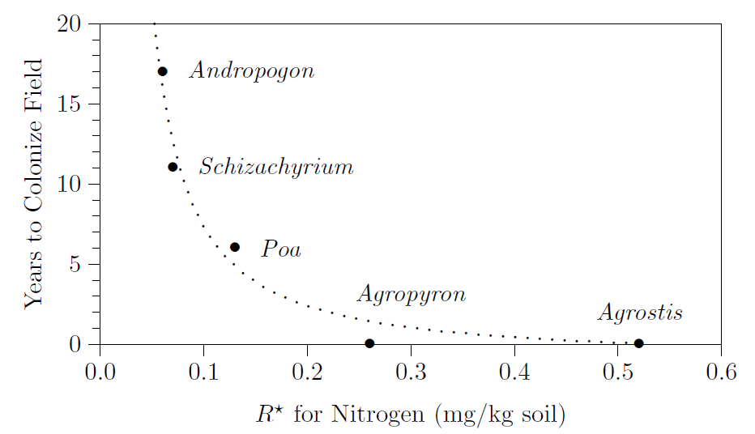{#fig-16-7 fig-alt="Years to colonize a field against R-star for nitrogen for five grass genera. Andropogon (about 17 years) and Schizachyrium (about 11 years) have the lowest R-star, Poa is intermediate, and Agropyron and Agrostis colonize almost immediately but have the highest R-star; a dotted curve falls steeply through the points." width="80%"}

In @fig-16-8, tradeoffs are formulated for modelling. Species 2 grows more rapidly when resources are abundant. This is the case at time 0, marked with $t_0$ on the top axis.

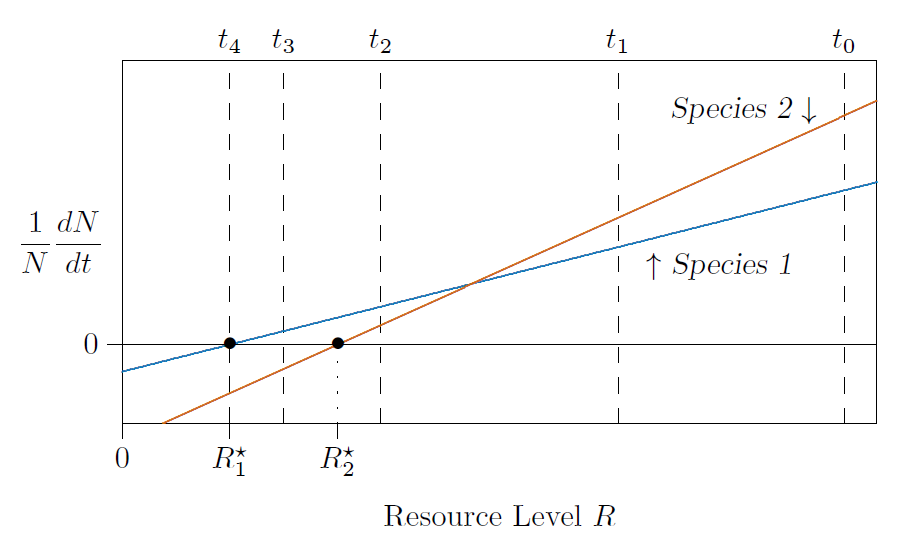{#fig-16-8 fig-alt="Individual growth rate against resource level R for two species. The red line for Species 2 is steeper and crosses zero at R2-star; the blue line for Species 1 is shallower and crosses zero at the lower R1-star. The lines cross at intermediate resource. Dashed vertical lines mark times t0 to t4 from high to low resource." width="80%"}

As the populations grow they reduce the amount of resource available in the environment. At time 1, marked with $t_1$ on the upper axis, Species 2 can continue to grow faster than Species 1, though the margin is deteriorating. But there comes a point at which the resources become depleted enough that the characteristics of Species 2 do not let it gather enough resources to maintain its advantage. This is the crossing point of the blue and red lines in the figure. At time 2, both species are still growing, but Species 1 is growing faster. At time 3, with still lower resource levels---drawn down by Species 1---the resource falls below the minimal level for Species 2, $R^\star_2$. The growth rate of Species 2 falls negative and Species 2 starts to die out.

Finally, at time 4, Species 1 depletes the resource to the level that it can just barely survive, and it stands alone, having wiped out its competitor. This process is called "competitive exclusion."

How this plays out over time is illustrated in @fig-16-9. At the top, Species 2 alone does just fine, rapidly rising to its carrying capacity of 50 and pulling the resource down to its $R^\star$ of 2. In the middle, Species 1 alone also does just fine, rapidly rising to its carrying capacity of 60 and pulling the resource down to its $R^\star$ of 1.

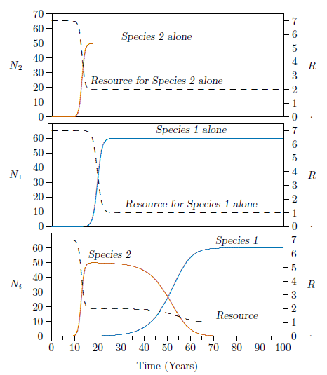{#fig-16-9 fig-alt="Three stacked time series over 100 years with resource shown as a dashed line on a right-hand axis. Top: Species 2 alone rises to 50 and resource falls to 2. Middle: Species 1 alone rises to 60 and resource falls to 1. Bottom: together, Species 2 rises to about 50 then declines to zero after year 60 while Species 1 rises slowly to 60 and resource falls in two steps to 1." width="80%"}

But grown together, Species 2 makes an initial splash and then declines. This is due to the incessant growth of Species 1, which outcompetes it. Species 1 simply draws the resource down below the level at which Species 2 can survive.

Competitive exclusion, which assumed that no more species could exist than there were resources, was treated as an inviolable law of ecology for over fifty years. In the 1970s, however, this was shown not to be the case (Armstrong and McGehee 1976, 1980). More about that later in the chapter.

## Succession

A similar process for more than two species results in a succession of species taking over, one after the other, in an ecological process known as "succession."

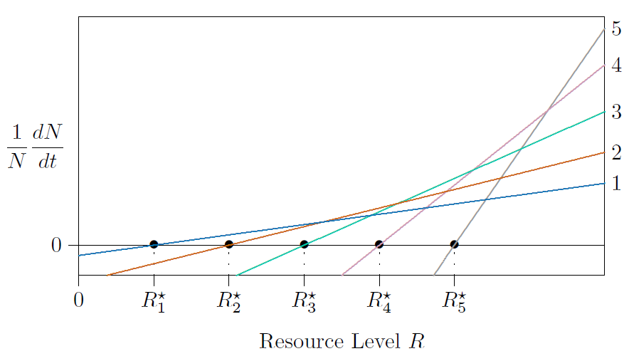{#fig-16-10 fig-alt="Individual growth rate against resource level R for five species, each a straight line crossing zero at successively higher R-star values, R1-star to R5-star. Species with higher R-star have steeper lines, so Species 5 grows fastest at high resource." width="80%"}

In natural systems many species compete, with tradeoffs between their $R^\star$ values and their growth rates, as in @fig-16-10. The following is a program (@lst-16-1) to simulate the differential equations for five species competing for the same resource and producing the curves of @fig-16-11. With only two species, this same program can produce the curves of @fig-16-9.

```{r}
#| lst-label: lst-16-1
#| lst-cap: "Simulating competition among five species for a single resource."
#| eval: false
# SIMULATE ONE YEAR
#
# This routine simulates competition differential equations through
# one time unit, such as one year, taking very small time steps
# along the way. Accuracy should be checked by reducing the size of
# small time steps until the results do not significantly change.
# This routine implements "Euler's Method" for solving differential
# equations, which always works if the time step is small enough.
#
# ENTRY: 'N1' to 'N5' are the starting populations for species 1-5.
#        'm1' to 'm5' specify the sensitivity of the corresponding
#         species to the available amount of resource.
#        'u1' to 'u5' specify the resource tied up in each species.
#        'R1star' to 'R5star' are the minimum resource levels.
#        'Rmax' is the greatest amount of resource possible.
#        'dt' is the duration of each small time step to be taken
#         throughout the year or other time unit.
#
# EXIT:  'N1' to 'N5' are the estimated populations of species 1-5
#         at the end of the time unit.
#        'R' is the estimated resource level at the end of the time
#         step.

Rmax=R=7;
R1star=1.0;  R2star=2.0;  R3star=3.0;  R4star=4.0;  R5star=5.0;
N1=0.00000001; N2=0.0000001; N3=0.000001; N4=0.00001; N5=0.0001;
m1=0.171468; m2=0.308642; m3=0.555556; m4=1.000000; m5=1.800000;
u1=0.1; u2=0.1; u3=0.1; u4=0.1; u5=0.1;

# SIMULATE ONE YEAR

SimulateOneYear = function(dt)
{ for(v in 1:(1/dt))                   # Advance a small time step.
  { R=Rmax-u1*N1-u2*N2-u3*N3-          # Compute resource remaining.
      u4*N4-u5*N5;

    dN1=m1*(R-R1star)*N1*dt;           # Estimate the change in the
    dN2=m2*(R-R2star)*N2*dt;           # population of each species.
    dN3=m3*(R-R3star)*N3*dt;
    dN4=m4*(R-R4star)*N4*dt;
    dN5=m5*(R-R5star)*N5*dt;

    N1=N1+dN1; N2=N2+dN2;              # Add the estimated change to
    N3=N3+dN3; N4=N4+dN4; N5=N5+dN5; } # each population and repeat.

  assign("N1",N1, envir=.GlobalEnv);   # At the end, export the
  assign("N2",N2, envir=.GlobalEnv);   # results and return.
  assign("N3",N3, envir=.GlobalEnv);
  assign("N4",N4, envir=.GlobalEnv);
  assign("N5",N5, envir=.GlobalEnv); }

# SIMULATE ALL YEARS

for(t in 0:100)                        # Advance one year.
{ print(round(c(t,N1,N2,N3,N4,N5)));   # Display results.
  SimulateOneYear(1/(365*24)); }       # Repeat.
```

An environment can change because species living in it have effects that can "feed back" and change the environment itself. In this case the feedback is change in the resource level, which each successive species changes in a way that is compatible with its own existence. There is nothing teleological in this; any species that change the environment in ways not compatible with their own existence simply do not persist, and hence are not observed.

When the program runs, it prints the population of each species once a year; these values are graphed in @fig-16-11.

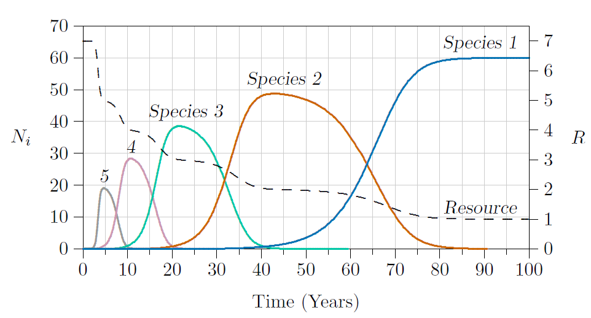{#fig-16-11 fig-alt="Abundance of five species and the resource level over 100 years. Species 5 peaks near 19 at about year 5, Species 4 near 28 at year 10, Species 3 near 38 at year 22, Species 2 near 49 at year 42, and Species 1 rises to 60 by year 85. The dashed resource line falls in steps from 7 to 1." width="80%"}

At the beginning in @fig-16-11, from time 0 to about time 3, the resource is at its maximum level, $R_{\rm max}$, and the abundances of all species are at very low levels. Between times 3 and 5---Species 5, the one with the highest growth rate when resources are abundant---increases rapidly while resources drop accordingly. But near the end of that time the next in the series, Species 4, starts to increase, pulling the resource down below the level that allows Species 5 to survive. Species 5 therefore declines while Species 4 increases.

This process continues in succession, with Species 3 replacing 4, 2 replacing 3, and, finally, Species 1 replacing 2. The resource falls in stages as each successive species gains dominance. Finally, when no more superior species exist, the system reaches what is called its "climax condition" at about time 90, with resources at a low level.

There is nothing especially remarkable about Species 1. It is simply (1) the best competitor living in the region, meaning better competitors cannot readily arrive on the scene, or (2) the best competitor that evolutionary processes have yet produced. In either case, it is subject to replacement by another---for example, by an "invasive species" arriving by extraordinary means.

Of course, succession in complex natural systems may not be as clear-cut as in our simple models. Multiple resources are involved, species may be very close to each other in their ecological parameters, and stochastic events may intervene to add confusion.

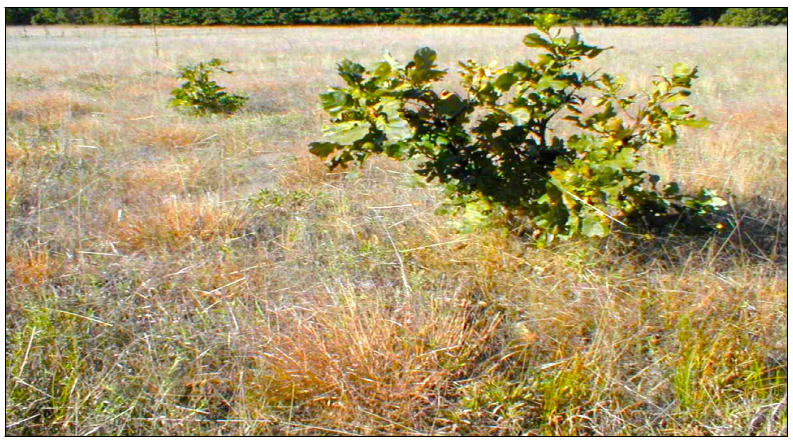{#fig-16-12 fig-alt="Photograph of a dry grassland of tawny bunchgrass with young oak saplings growing up through it." width="80%"}

## Single-resource phase space

Some aspects of competition for a resource are clarified by looking at the phase space, as introduced in @sec-phase-space. Combining @eq-16-3 and @eq-16-4 gives the following as a starting point:

$$
\begin{aligned}
\frac{1}{N_1}\frac{dN_1}{dt} &= m_1(R_{\rm max}-R_1^\star) - u_1 m_1 N_1 - u_2 m_1 N_2 \\
\frac{1}{N_2}\frac{dN_2}{dt} &= \underbrace{m_2(R_{\rm max}-R_2^\star)}_{r_i}\ \underbrace{-\,u_2 m_2 N_2}_{s_{i,i}N_i}\ \underbrace{-\,u_1 m_2 N_1}_{s_{i,j}N_j}
\end{aligned}
$$ {#eq-16-5}

As before, $m_i$ is the rate of growth of Species $i$ for each level of resource above its minimum resource requirement $R_i^\star$, and $u_i$ is the amount of resource tied up in each individual of Species $i$. For reference, here is the assignment of parameters in terms of $r_i$ and $s_{i,j}$.

$$
\begin{aligned}
r_1 &= m_1(R_{\rm max}-R_1^\star), & s_{1,1} &= -u_1 m_1, & s_{1,2} &= -u_2 m_1 \\
r_2 &= m_2(R_{\rm max}-R_2^\star), & s_{2,1} &= -u_1 m_2, & s_{2,2} &= -u_2 m_2
\end{aligned}
$$ {#eq-16-6}

Where in the phase space will the growth rate be 0 for each species? For Species 1 it will be where

$$
\frac{1}{N_1}\frac{dN_1}{dt} = 0 = r_1 + s_{1,1}N_1 + s_{1,2}N_2
$$

Solving for $N_2$ gives

$$
N_2 = -\frac{r_1}{s_{1,2}} - \frac{s_{1,1}}{s_{1,2}} N_1 \leftarrow \ \text{Species 1 isocline}
$$ {#eq-16-7}

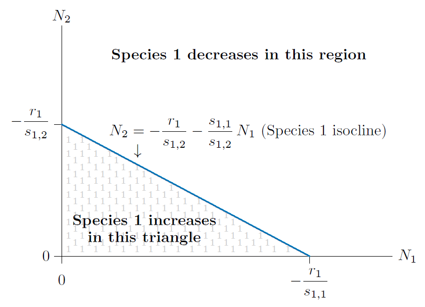{#fig-16-13 fig-alt="Phase space with N1 horizontal and N2 vertical. A blue line, the Species 1 isocline, runs from -r1/s12 on the vertical axis to -r1/s11 on the horizontal axis. The triangle below it, filled with gray numerals 1, is where Species 1 increases; above it Species 1 decreases." width="80%"}

Anywhere along that line, the population of Species 1 will not change, but on either side of the line it will (@fig-16-13). Formulae for the four possible equilibria and their stability are in @tbl-10-1. The vertical intercept of the isocline, where $N_1=0$, is $-r_1/s_{1,2}$, and the horizontal intercept, where $N_2=0$, is $-r_1/s_{1,1}$. The slope is $-s_{1,1}/s_{1,2}=-u_1/u_2$.

Similarly, growth of Species 2 will be 0 where

$$
\frac{1}{N_2}\frac{dN_2}{dt} = 0 = r_2 + s_{2,2}N_2 + s_{2,1}N_1
$$

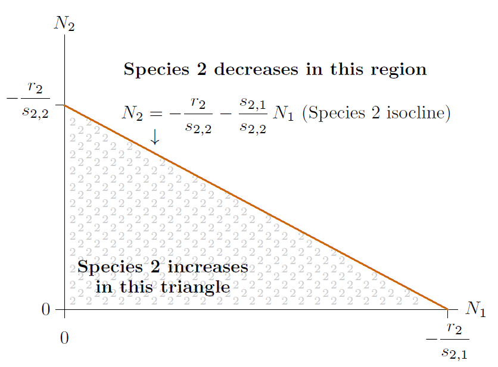{#fig-16-14 fig-alt="Phase space with a red line, the Species 2 isocline, running from -r2/s22 on the vertical axis to -r2/s21 on the horizontal axis. The triangle below it, filled with gray numerals 2, is where Species 2 increases; above it Species 2 decreases." width="80%"}

Solving for $N_2$ gives

$$
N_2 = -\frac{r_2}{s_{2,2}} - \frac{s_{2,1}}{s_{2,2}} N_1 \leftarrow \ \text{Species 2 isocline}
$$ {#eq-16-8}

Again, anywhere along that line the population of Species 2 will not change, but on either side of the line it will (@fig-16-14). The vertical intercept of that line, where $N_1=0$, is $-r_2/s_{2,2}$, the horizontal intercept, where $N_2=0$, is $-r_2/s_{2,1}$, and the slope is $-s_{2,1}/s_{2,2}=-u_1/u_2$.

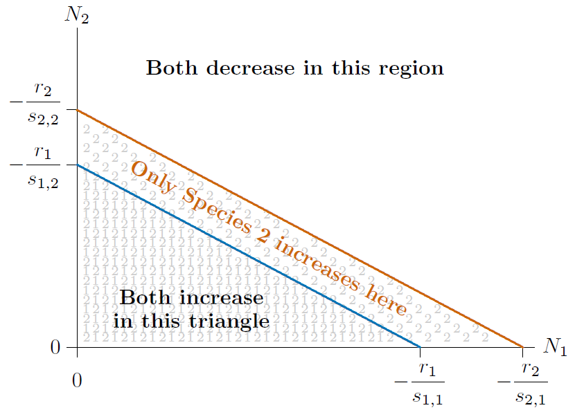{#fig-16-15 fig-alt="Phase space with the blue Species 1 isocline lying parallel to and below the red Species 2 isocline. Both species increase in the triangle below the blue line, only Species 2 increases in the band between the lines, and both decrease above the red line." width="80%"}

Notice this: In terms of the resource, the slope of the isocline for Species 2 is identical to the slope for Species 1---both are equal to $-u_1/u_2$. What does this mean? It means that the two isoclines are parallel. And that, in turn, means that the two species cannot permanently coexist.

The populations can fall into only one of the three regions of @fig-16-15. If they start in the upper region, they decrease until they enter the middle region. If they start in the lower region, they increase until they also enter the middle region. Once in the middle region, only Species 2 increases. That means the population of Species 1 is driven leftward, toward lower values of $N_1$, while the population of Species 2 is driven upward, toward higher values of $N_2$.

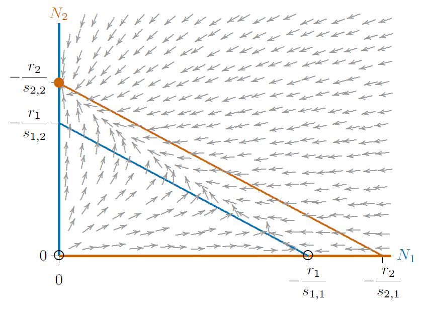{#fig-16-16 fig-alt="Phase space with parallel blue and red isoclines and a field of gray arrows. Arrows flow away from open circles at the origin and at -r1/s11 on the horizontal axis and converge on a filled red disc at -r2/s22 on the vertical axis." width="80%"}

These dynamics show up in the flow diagram of @fig-16-16. The origin (0,0) is an unstable equilibrium. In this single-resource system, any populations near extinction, but not completely extinct, increase until they hit the middle region. The horizontal axis has another unstable equilibrium, where Species 1 is at its carrying capacity and Species 2 is extinct $(-r_1/s_{1,1},0)$. Any populations near that unstable equilibrium soon arrive in the middle region. All populations not precisely on one of those two unstable equilibria converge on the red disc on the vertical axis, where Species 2 is at its carrying capacity, $K_2=-r_2/s_{2,2}$, and Species 1 is extinct $(0,-r_2/s_{2,2})$. This equilibrium is called a "global attractor."

Phase spaces thus provide another view of competitive exclusion, the theory of which applies at least to two species competing for a single resource at equilibrium.

## Multiple resource phase space

As the next step, consider the case of two essential resources. This can be done mathematically following the approach we used earlier for a single resource.

Call the two resources $R_A$ and $R_B$. Suppose that of the total of these two resources used by Species 1, a proportion $p_1$ is Resource A and therefore a proportion $q_1=1-p_1$ is Resource B. Likewise, for Species 2 a proportion $p_2$ is Resource A and $q_2=1-p_2$ is Resource B.

This is confusing, so for a clarifying example, suppose $R_A$ is phosphate, $\mathrm{PO_4}$, and $R_B$ is silicate, $\mathrm{SiO_2}$, both essential to two species of algae in a waterway. Take Species 1 to be an *Asterionella* species and Species 2 to be a *Cyclotella* species, as in a pioneering study by David Tilman (1977). In this case, Species 1 needs phosphate and silicate resources in about a 1:99 ratio, while Species 2 needs them in about a 6:94 ratio. If silicate is low, Species 1 will thus suffer first, since it needs a larger proportion of it, while Species 2 will suffer first if phosphate is low, for the related reason. Here it would be $p_1=0.01$, $q_1=1-p_1=0.99$ for the use of Resources A and B by Species 1, and $p_2=0.06$, $q_2=1-p_2=0.94$ for use by Species 2.

With $u_1$ being the total amount of resource tied up by each individual of Species 1, $p_1\,u_1$ will be the amount of Resource A tied up by Species 1 and $q_1\,u_1$ the amount of Resource B tied up the same way. Similarly, $p_2\,u_2$ will be the amount of Resource A tied up by each individual of Species 2 and $q_2\,u_2$ the amount of Resource B. Also, assume as before that the resources under consideration disappear from the environment when they are taken up by individuals newly born, and are released immediately when individuals die.

With this in mind, the resources remaining at any time, as functions of the maximum resource and the abundance of each species, will be

$$
\begin{aligned}
R_A &= R_{A\rm max} - p_1 u_1 N_1 - p_2 u_2 N_2 \\
R_B &= R_{B\rm max} - q_1 u_1 N_1 - q_2 u_2 N_2
\end{aligned}
$$ {#eq-16-9}

Suppose that populations of Species 1 and 2 grow based on which resource is closest to the $R^\star$ experienced by that species for the resource. This can be represented by the "min" function, $\min(a,b)$, which selects the smaller of two values. For example, $\min(200,10)=10$, $\min(-200,10)=-200$. Now the two-species, two-resource growth equations, generalizing the single-species, single-resource growth in @eq-16-1, are

$$
\begin{aligned}
\frac{1}{N_1}\frac{dN_1}{dt} &= m_1\,\min(R_A-R_{1A}^\star,\, R_B-R_{1B}^\star) \\
\frac{1}{N_2}\frac{dN_2}{dt} &= m_2\,\min(R_A-R_{2A}^\star,\, R_B-R_{2B}^\star)\,.
\end{aligned}
$$

This could be refined, so that the growth rates $m_1$ and $m_2$ would depend on which resource was limiting, but this does not matter in the present analysis.

If the species are similar enough and the resource level is such that they are limited by the same resource, one will tend to be competitively excluded, as in the previous section. But if the two species are quite different, they can be limited by different resources and the equations can be simplified.

$$
\begin{aligned}
\frac{1}{N_1}\frac{dN_1}{dt} &= m_1(R_A-R_{1A}^\star) \\
\frac{1}{N_2}\frac{dN_2}{dt} &= m_2(R_B-R_{2B}^\star)
\end{aligned}
$$ {#eq-16-10}

Some algebra will reveal the basic properties. If you substitute the expressions for $R_A$ and $R_B$ from @eq-16-9 into @eq-16-10 you will get

$$
\begin{aligned}
\frac{1}{N_1}\frac{dN_1}{dt} &= m_1\,(R_{A\rm max} - p_1 u_1 N_1 - p_2 u_2 N_2 - R_{1A}^\star) \\
\frac{1}{N_2}\frac{dN_2}{dt} &= m_2\,(R_{B\rm max} - q_1 u_1 N_1 - q_2 u_2 N_2 - R_{2B}^\star)
\end{aligned}
$$

Now if you expand, collect, and rearrange terms, you get this equivalent form:

$$
\begin{aligned}
\frac{1}{N_1}\frac{dN_1}{dt} &= m_1\,(R_{A\rm max}-R_{1A}^\star) - m_1\,p_1 u_1\,N_1 - m_1\,p_2 u_2\,N_2 \\
\frac{1}{N_2}\frac{dN_2}{dt} &= \underbrace{m_2(R_{B\rm max}-R_{2B}^\star)}_{r_i}\ \underbrace{-\,m_2\,q_2 u_2\,N_2}_{s_{i,i}N_i}\ \underbrace{-\,m_2\,q_1 u_1\,N_1}_{s_{i,j}N_j}
\end{aligned}
$$ {#eq-16-11}

Notice that, again, a mechanistic model with measurable parameters is just the general ecological [rsn]{.smallcaps} model in disguise.

The [rsn]{.smallcaps} formulation can expose the possibilities of two-resource situations in phase space. The isoclines are Equations [-@eq-16-7] and [-@eq-16-8] of this chapter, with slopes $-s_{1,1}/s_{1,2}$ and $-s_{2,1}/s_{2,2}$ for Species 1 and 2, respectively.

These two slopes can be written in terms of the resource. With the values for $s_{i,j}$ from @eq-16-11 ($s_{1,1}= -m_1\,p_1 u_1$, $s_{1,2}= -m_1\,p_2 u_2$, $s_{2,1}= -m_2\,q_1 u_1$, and $s_{2,2}= -m_2\,q_2 u_2$), the slopes of the isoclines become

$$
\begin{aligned}
\frac{s_{1,1}}{s_{1,2}} &= \frac{-m_1\,p_1 u_1}{-m_1\,p_2 u_2} = \frac{u_1}{u_2}\,\frac{p_1}{p_2} \\
\frac{s_{2,1}}{s_{2,2}} &= \frac{-m_2\,q_1 u_1}{-m_2\,q_2 u_2} = \frac{u_1}{u_2}\,\frac{1-p_1}{1-p_2}
\end{aligned}
$$

First notice that if the two species use the two resources in equal proportions (if $p_1=p_2$), both slopes become $u_1/u_2$. The slopes are parallel, as in the single-resource case in Figures [-@fig-16-13] through [-@fig-16-16]. Therefore, if two species use two different resources identically---that is, in equal proportions---they do not coexist. Coexistence requires some difference in how they use resources.

However, using the resources differently does not guarantee coexistence. Depending on their $p$'s and $q$'s, one isocline could still enclose the other completely. @fig-16-17 has the same properties as @fig-16-16. Everywhere below the red isocline, Species 2 will increase, including the broad band between the red and blue isoclines where Species 1 will decrease.

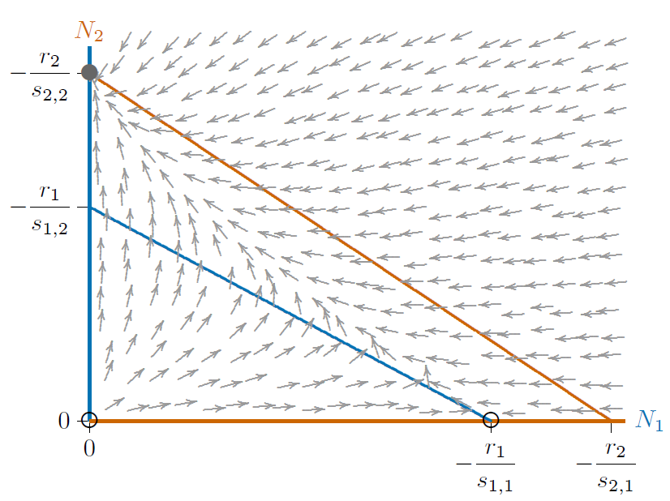{#fig-16-17 fig-alt="Phase space with non-parallel isoclines, the red Species 2 isocline lying entirely above the blue Species 1 isocline. Gray flow arrows converge on a filled circle at -r2/s22 on the vertical axis; open circles at the origin and at -r1/s11 are unstable." width="80%"}

If the blue and red isoclines are reversed, the result is similar, but with Species 1 excluding Species 2. @fig-16-18 shows this, with the arrows reversed as Species 1 increases everywhere below the blue isocline, including the broad band between the isoclines where Species 2 decreases.

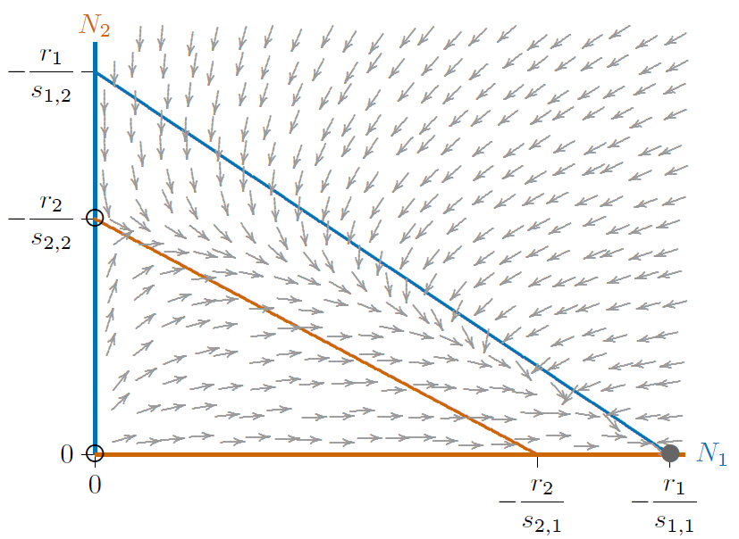{#fig-16-18 fig-alt="Phase space with the blue Species 1 isocline lying entirely above the red Species 2 isocline. Gray flow arrows converge on a filled circle at -r1/s11 on the horizontal axis; open circles at the origin and at -r2/s22 are unstable." width="80%"}

In all three cases, from Figures [-@fig-16-16] to [-@fig-16-18], the system has three equilibria---at the origin $(0,0)$, where both species are absent, at the carrying capacity $K_1$ for Species 1 alone $(-r_1/s_{1,1},0)$, and at the carrying capacity $K_2$ for Species 2 alone $(0, -r_2/s_{2,2})$. The origin is unstable and only one of the other two equilibria is stable, depending on which isocline encloses the other.

Figures [-@fig-16-17] and [-@fig-16-18] can be combined to give each species a chance to exclude the other, depending on circumstances. This means not allowing one isocline to completely enclose the other, as in @fig-16-19. Intersecting isoclines introduce a fourth equilibrium at the interior of the phase space. This equilibrium is unstable, marked with an open circle, and the two equilibria for the individual species, on the axes, are stable. They are no longer "globally stable," however, since only local regions of the phase space lead to either of them.

Depending on where the populations start, one of the two species will exclude the other. A curve called a ["separatrix,"](https://en.wikipedia.org/wiki/Separatrix_(mathematics)) dividing these starting points according to which species will exclude the other, is shown with the dashed black line in @fig-16-20. That separatrix corresponds to a long curved ridge in any surface above the phase space, as described in @sec-phase-space. It necessarily passes through the unstable interior equilibrium. Here it is a simple curve, though in some cases (such as the [Mandelbrot system](https://en.wikipedia.org/wiki/Mandelbrot_set), not representing competition), related curves can be infinitely complex.

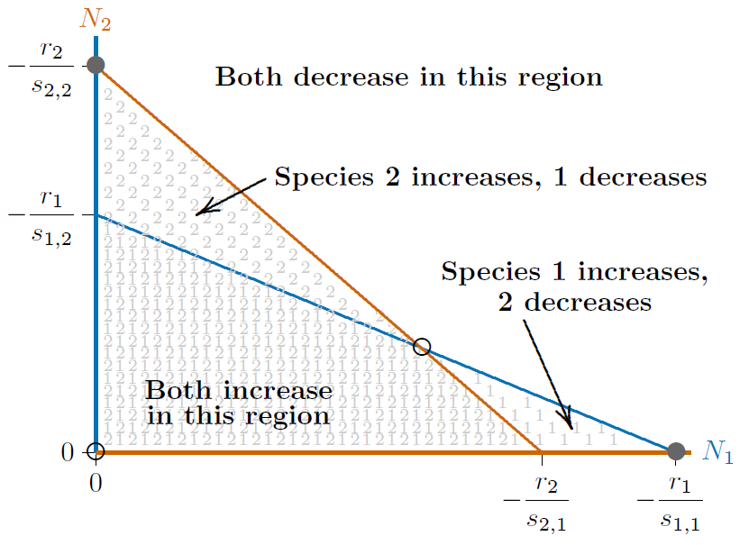{#fig-16-19 fig-alt="Phase space with the red Species 2 isocline steeper than the blue Species 1 isocline, crossing at an open circle. Filled circles at -r2/s22 on the vertical axis and -r1/s11 on the horizontal axis mark the two stable equilibria; labelled regions show where both increase, both decrease, or only one species increases." width="80%"}

Finally, the isoclines can intersect in the opposite way, as in @fig-16-21. In this case, unlike in the phase spaces of Figures [-@fig-16-16] through [-@fig-16-20], neither isocline encloses the other anywhere in the phase space. What will happen when neither species can exclude the other in any part of the phase space? They are forced to coexist. The individual equilibria on the axes become unstable and the interior equilibrium becomes stable---indeed, globally stable.

{#fig-16-20 fig-alt="Phase space with crossing isoclines and gray flow arrows. A black dashed separatrix runs from the origin through the open interior equilibrium; arrows above it flow to the filled circle on the vertical axis and arrows below it flow to the filled circle on the horizontal axis." width="80%"}

In summary, the isoclines in competitive systems have four different configurations, as in @fig-16-22. Cases 1 and 2 can represent competition for a single resource or, equivalently, competition for two different resources that the two species handle identically. One of the two is a superior competitor that excludes the other. Case 3 is "bistable," where either of the species can exclude the other, depending on how the system starts out. Finally, Case 4 is globally stable, where neither species can exclude the other, and stable coexistence prevails. Cases 3 and 4 can represent competition for two different resources.

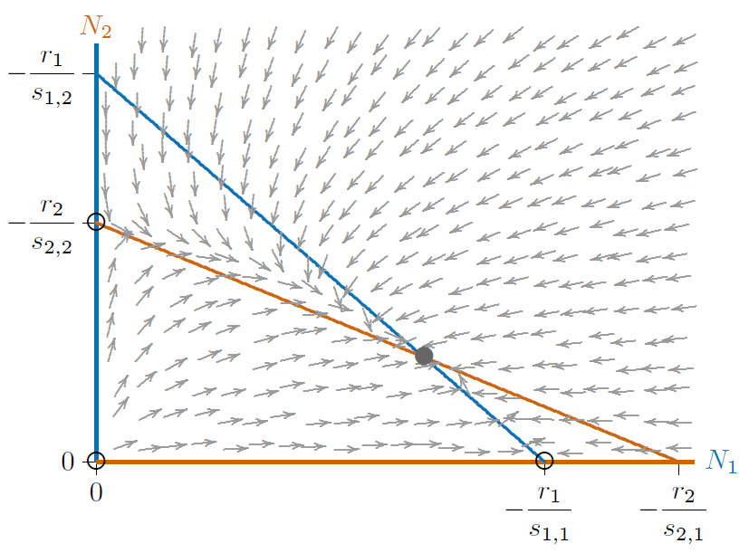{#fig-16-21 fig-alt="Phase space with the blue Species 1 isocline steeper than the red Species 2 isocline, crossing at a filled interior circle. Gray flow arrows from everywhere converge on this coexistence equilibrium; open circles at the origin and on both axes are unstable." width="80%"}

## Lotka--Volterra formulation

Competition equations are usually presented in textbooks as the [Lotka--Volterra competition model](https://en.wikipedia.org/wiki/Competitive_Lotka–Volterra_equations). This first appeared in the ecological literature in the 1920s and is defined not just in terms of the interactions among species, but also in terms of the species' carrying capacities, as follows.

$$
\begin{aligned}
\frac{1}{N_1}\frac{dN_1}{dt} &= r_1 \left(1-\frac{N_1+a_{1,2} N_2}{K_1}\right) \\
\frac{1}{N_2}\frac{dN_2}{dt} &= r_2 \left(1-\frac{N_2+a_{2,1} N_1}{K_2}\right)
\end{aligned}
$$ {#eq-16-12}

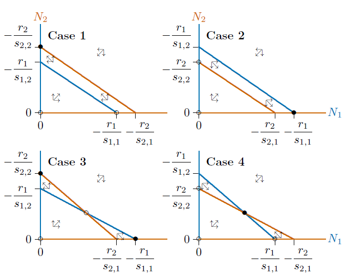{#fig-16-22 fig-alt="Four small phase-space panels. Case 1: red isocline above blue, stable point on the vertical axis. Case 2: blue above red, stable point on the horizontal axis. Case 3: isoclines cross at an open circle with stable points on both axes. Case 4: isoclines cross at a filled interior circle." width="80%"}

$K_1$ and $K_2$ are the carrying capacities for Species 1 and 2, respectively. Parameters $a_{1,2}$ and $a_{2,1}$ represent the interference by each species on the other. If $a_{1,2}=2$, for example, each individual of Species 2 interferes with the growth of Species 1 as if it were two individuals of Species 1. If, on the other hand, $a_{1,2}=1/2$, it takes two individuals of Species 2 to have the same negative effect on the growth of Species 1 as one individual of Species 1 itself.

To compare this with the [rsn]{.smallcaps} formulation, represent @eq-16-12 with $i$ and $j$ subscripts

$$
\frac{1}{N_i}\frac{dN_i}{dt} = r_i \left(1-\frac{N_i+a_{i,j} N_j}{K_i}\right)
$$

and multiply the right hand side through by $r_i$,

$$
\frac{1}{N_i}\frac{dN_i}{dt} = r_i - \frac{r_i}{K_i}N_i - \frac{a_{i,j}\, r_i}{K_i} N_j
$$

This shows that the Lotka--Volterra formulation is isomorphic to the [rsn]{.smallcaps} formulation. All conclusions about competitive systems examined thus far apply to the Lotka--Volterra formulation as well, with the appropriate translation of parameters. Parameter $r_i$ is the same in both the Lotka--Volterra formulation and the [rsn]{.smallcaps} formulation, but $s_{i,i}=-r_i/K_i$ and $s_{i,j}=-a_{i,j}\,r_i/K_i$.

Beware, however, of a widely quoted statement derived from this formulation that appears throughout the ecological literature and textbooks. Statements like "Coexistence requires that each species inhibit itself more than it inhibits the other species" are abundant in textbooks and in the ecological literature. Alas, those statements are not correct.

To see this, examine @fig-16-21. Here Species 2 inhibits itself with $s_{2,2}=-1$, while it inhibits Species 1 more strongly, with $s_{1,2}=-1.153$. Yet there is global coexistence. Evidently, coexistence *does not* require that each species inhibit itself more than it inhibits the other, as in the conventional wisdom.

The confusion in the literature has apparently emerged from the presence of the carrying capacity terms, $K_1$ and $K_2$, in the Lotka--Volterra formulation. These terms obscure the effects of the interaction terms, $a_{1,2}$ and $a_{2,1}$, when carrying capacities differ between the species.

::: {#box-16-1}
*Coexistence in the Lotka--Volterra model requires that each species be able to increase from low densities when the other species is at its single-species equilibrium.*

A condition for coexistence.
:::

What, then, is a correct statement about coexistence? It can be put in terms of increasing from low densities, as shown in @box-16-1. The qualifying phrase "*from low densities*" is required, because the species not present can increase from high densities in a bistable system, as in @fig-16-20, and flip it to the other state, even though coexistence cannot occur.

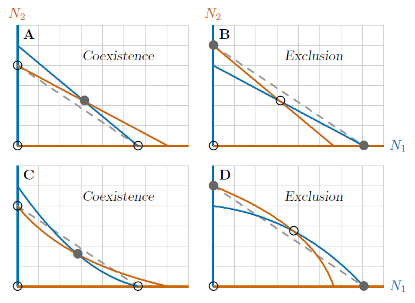{#fig-16-23 fig-alt="Four small phase-space panels with a dashed gray line joining the single-species equilibria. A: straight isoclines with the joint equilibrium above the line, coexistence. B: straight isoclines with the joint equilibrium below the line, exclusion. C and D: curved isoclines where coexistence occurs with the equilibrium below the line (C) and exclusion with it above the line (D)." width="80%"}

Another way in which coexistence has been explained is by Vandermeer (1981, *Bioscience*), connecting coexistence with a certain kind of "overyielding," wherein two crops require less land for the same annual productivity when growing together than when growing apart. The test is whether the joint equilibrium is above a line connecting the single-species equilibria (dashed gray in @fig-16-23 A) or below the line (@fig-16-23 B).

This view is correct for models we have been considering with straight-line isoclines, but incorrect for more general models with curved isoclines (@fig-16-23 C, D). The statement in @box-16-1, however, holds true in each of these cases.

All things considered, rather than relying on rules of thumb, it can be better to evaluate a system directly, for example with the methods of eigenvectors and eigenvalues described in @sec-phase-space.
